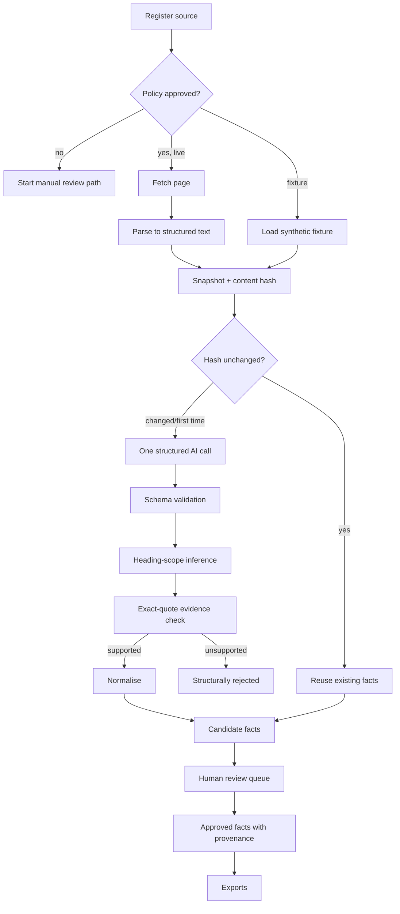

# PracticeSignal — Healthcare Practice & Workforce Intelligence

> **Document type:** Final implementation-ready specification (Phase 0.5 reconciliation complete)
> **Status:** Approved for implementation in milestone order; per-milestone gates defined in `docs/IMPLEMENTATION_PLAN.md`
> **Product name:** PracticeSignal — provisional; no trademark/domain/collision check performed yet (tracked in §9.1)
> **Prepared:** 4 November 2026
> **Primary constraint:** ₹0 budget — no paid subscriptions, APIs, datasets, hosting, trial accounts, or anything requiring a credit card
> **Supersedes:** all prior drafts, including material under the working name *CareScout* (references below are historical)
> **Companion documents:** `docs/DECISION_LOG.md` (decisions D1–D13 with rationale) · `docs/SOURCE_REGISTER.md` (approvals & fixtures) · `docs/IMPLEMENTATION_PLAN.md` (milestones, acceptance criteria, unresolved issues)

---

## 1. Executive decision

**PracticeSignal** is a local-first healthcare practice & workforce intelligence prototype. It ingests a deliberately limited set of publicly available information from explicitly registered practice/healthcare-organisation sources — live scraping only after per-source policy approval; otherwise clearly labelled synthetic fixtures — converts it into structured records, attaches verifiable evidence to every extracted fact, detects changes and inconsistencies, and presents potential workforce opportunities for human review.

Assessment deliverables carried verbatim from the original brief (unchangeable):

1. a working project;
2. a video presentation of at least two minutes;
3. complete prompt documentation including meaningful revisions;
4. an accessible project link.

### Relevance

The AI Growth & Automation Associate role combines business growth, public healthcare-data collection (doctors, nurses, hospitals), Python automation and AI. PracticeSignal demonstrates a source→evidence→review→export workflow in exactly that space. It is an independent prototype relevant to the role's context — **not** an implementation of Gokul Infocare's internal MIRA project; no affiliation is claimed.

### What the product is not

Not a clinic chatbot, medical decision system, automated recruiter, mass-email lead generator, appointment system, or clone of a national directory.

---

## 2. Research findings and evidence boundary

Retained from the Phase 0 review (full table preserved in the superseded draft; conclusions operationalised here):

1. Public visibility is **not** blanket permission to collect/repurpose personal information (OAIC APP 3, incl. 13 May 2026 update on scraping & AI).
2. Consent cannot be inferred from published contact details → the prototype never sends commercial electronic messages (ACMA).
3. Healthdirect NHSD requires partner/test agreements — excluded from the dependency chain.
4. Similar-looking facts may differ in scope; conflicts compare only matching entity + field + scope + time context.
5. Robina 7 Day Doctors robots.txt/terms status is **unverified**; the source is fixture-only until manually checked (§3, `docs/SOURCE_REGISTER.md`).
6. MIRA's internal architecture, sources and integrations are publicly undocumented — accordingly no MIRA integration is designed or claimed.

---

## 3. Source policy (normative)

### 3.1 Rules

- **No arbitrary fetching.** The application fetches only explicitly registered sources on allowlisted hosts. A pasted URL is never sufficient; every fetchable host/path completes registration first.
- **One source, one decision.** Automated collection is permitted only when that source completes the approval procedure in `docs/SOURCE_REGISTER.md`: robots.txt check, terms/privacy review, data-category fit against `intended_fields`, documented purpose, named approver, review date.
- **Unknown policy ⇒ fixture.** An unverified source is registered as `manual_fixture_pending_policy_check` and the pipeline runs on **synthetic fixtures** reproducing the relevant page structure. No automated crawling of the real site occurs.
- **Fixtures are never mislabelled.** Fixture-derived records carry a visible `fixture` provenance label in the sources table, evidence drawer and exports. Fixture ingestion is never presented as a live scrape in UI, docs, evaluation or the demo video.
- **Blocking is respected.** On 403/429/CAPTCHA/auth-wall/explicit anti-bot response the fetcher stops and marks the source unavailable-for-automated-fetch. No circumvention, identity rotation, proxies, or aggressive retry.
- **Conservative transport:** HTTP/HTTPS only; one request at a time per host; configurable minimum delay (default 3 s); explicit connect/read timeouts; maximum response size; maximum pages per run; descriptive User-Agent with a contact note; robots.txt honoured per path; ETag/Last-Modified used when supplied; fetch status stored separately from content status.

### 3.2 Current sources

Robina 7 Day Doctors pages (home, services, contact, team, vacancies, policies) remain the **reference structure for synthetic fixtures** — they demonstrate the data lifecycles the system must handle (stable org details, service descriptions, scoped opening hours, time-sensitive vacancies, external booking links). Live status: all `manual_fixture_pending_policy_check`; `docs/SOURCE_REGISTER.md` is the single source of truth, including the future-source approval procedure beyond it.

---

## 4. Data scope, minimisation and safety (normative)

**V1 supports exactly:** practice/organisation name; public practice location/address; official website; publicly published practice telephone and email (business contact only); service names and categories; publicly advertised doctor/nurse recruitment opportunities; provenance for every fact (source URL, retrieved timestamp, evidence excerpt, review status).

**Never collected:** patient records/enquiries; sensitive attributes (health status, ethnicity, age, family or immigration status); personal/home contact details; bulk named-clinician profiles; social-media content; applicant data (no CV intake, ranking, or automated recruitment decisions); testimonials.

Controls:

1. **Field allowlist per source** (`intended_fields`, D6): only registered categories may produce records; candidates outside the allowlist are rejected before persistence. This — not model judgement — is the primary minimisation control.
2. **Business-contact rule:** contact-like values found in review/testimonial context are rejected deterministically; a phone number in a patient testimonial must not become practice contact data.
3. **No outbound path:** no automated email/SMS anywhere in the codebase. Exported contact fields are labelled "manual review; no consent inferred".
4. **Retention/erasure (D8):** deleting a source cascade-removes its snapshots, facts, evidence and derived records; retention procedure in `docs/SOURCE_REGISTER.md`.
5. **Timezone-explicit timestamps:** default `Australia/Brisbane`, never silently assumed; local time windows stored with their timezone.

This section is an engineering safeguard informed by published guidance — not legal advice; commercial collection of identifiable practitioner information still needs an independent privacy/legal review per source (§10, §16).

---

## 5. AI design and prompt engineering

**Runtime (D2):** default model is `llama3.2:3b` served by the host's Ollama (0.40.14) through a local HTTP adapter:

- tag pinned; **Llama 3.2 Community License** documented accurately in `docs/DECISION_LOG.md`; **model weights are not redistributed** by us — the operator pulls from the official registry under its own terms;
- no additional model downloads without a measured reason (benchmarked latency/quality deficiency; D3);
- `nomic-embed-text` exists on the host but is unused in V1 — no embeddings, no vector store.

**Inference strategy (D4):**

- exactly **one structured-output call per page whose content hash changed**; classification + extraction combined in a single prompt; hash unchanged ⇒ skip inference, reuse prior facts;
- bounded page excerpt + strict JSON schema via Ollama's structured-output (`format`); the model consumes untrusted page text and produces JSON candidates;
- prompt templates are versioned files in `prompts/` with real iteration history recorded in `docs/prompt-engineering-log.md`.

**Prompt-injection posture (D10):** the prompt states that page content is untrusted data and contains no instructions, but the actual guarantee is structural: strict schema validation, exact-quote verification, allowlist rejection and human review. Nothing extracted from a page can act or persist without passing those gates; injected "facts" survive only if they quote-verify against ingested text, and even then remain `candidate` until review.

**Model may:** classify page type; propose organisation/service/hours candidates; propose vacancy candidates (published title, public location, stated employment type, published qualifications wording); propose scope where the page clearly states it; cite one evidence quote per field; flag ambiguity.
**Model may not:** approve facts, resolve conflicts, decide live availability, infer personal attributes or eligibility, contact anyone, use tools/network/shell, or override the allowlist.

**Small-model honesty:** all output is `candidate`; confidence is a diagnostic field, never a trust signal; evaluation reports raw counts alongside percentages and never presents a small-n score as a production guarantee (§9.4).

**Prompt suite:** classification V1; organisation/service/hours extraction V1; evidence-constrained V2; context-aware scope V3; vacancy V1; injection-guard V1. Final versions are settled by measured evaluation, not preference.

---

## 6. Architecture: components and repository

### 6.1 Component responsibilities (each maps 1:1 to a repo module)

| Component | Responsibility (single owner of its concern) |
|---|---|
| `sources.registry` | Source CRUD, allowlist state, approval metadata, source deletion cascade |
| `sources.policy_gate` | Pre-fetch validation: scheme/host allowlist, robots per path, IP blocklist, limits; rejects before any outbound request |
| `sources.fetcher` | Controlled HTTP fetch; manual redirect loop with per-hop validation; response size/timeout limits; ETag/Last-Modified |
| `sources.fixture_loader` | Local synthetic fixtures; labels their provenance; never contacts the network |
| `parsing.text_extract` | HTML → structured text preserving heading chains; strips scripts/styles/hidden; records parser version |
| `ingest.snapshot_store` | Fetch-run persistence, snapshot immutability, content-hash computation & staging |
| `ingest.evidence_verifier` | Exact-quote verification with offsets; structural rejection of unsupported values (D10) |
| `ingest.field_normalizer` | Deterministic normalization (names, roles, hours, phones, URLs); preserves raw value on failure (D7) |
| `ai.client` | Ollama adapter only (`generate(prompt, schema, options)`); owns model tag, timeouts, retries |
| `ai.prompt_store` | Loads versioned prompt templates, injects bounded excerpts, records prompt runs |
| `extraction.candidates` | Runs schema-validated extraction → candidate records with evidence + prompt link |
| `intelligence.conflicts` | Compared only on matching entity/field/scope/time; ambiguous scope ⇒ review, never `conflicting` |
| `intelligence.dedupe` | Conservative duplicate suggestions via rapidfuzz; never auto-merges (D12) |
| `intelligence.freshness` | Content-hash change detection; feature states; vacancy staleness supervision |
| `ingest.scope_assignment` | Heading-based deterministic scope assignment; unresolvable ⇒ needs_review (D11) |
| `review.workflow` | Approve/reject/correct/defer/merge-after-confirmation; immutable audit trail |
| `exports.renderers` | Provenance-complete CSV + JSON |
| `api.routers` | FastAPI; contracts versioned (§6.2); OpenAPI-generated docs |
| `frontend` (`pages/`, `components/`) | Screens per §11 V1; types are generated, never hand-written (D19) |

### 6.2 API contracts (key routes — errors via standard FastAPI exception handlers; pagination `limit`/`offset`; timestamps timezone-explicit; types generated from these schemas)

| Method | Path | Purpose |
|---|---|---|
| POST | `/api/sources` | Register a source, policy-gated (`kind`: `url` \| `fixture`) |
| GET/PATCH/DELETE | `/api/sources/{id}` | List/inspect/update/deletion (DELETE cascades per D8) |
| POST | `/api/ingestions/{source_id}` | Trigger ingestion — fetch or fixture load |
| GET | `/api/ingestions` | Run history, fetched status, per-source |
| GET | `/api/organisations` · `/api/organisations/{id}` | Search/inspect; details include facts+evidence+scope |
| GET | `/api/opportunities` · `/api/opportunities/{id}` | Vacancies with lifecycle and provenance |
| GET | `/api/facts` | Filter by status/scope/entity |
| PATCH | `/api/facts/{id}/review` | Review actions (approve/reject/defer/incorporate), audit-recorded |
| GET | `/api/changes` | Change log between snapshots |
| GET | `/api/prompts` · `/api/prompt-runs` | Versioned templates and AI runs |
| GET | `/api/exports?type=…&format=csv\|json&status=reviewed` | Provenance-complete export |
| GET | `/api/health` | App, DB, Ollama and robots-tool status |

### 6.3 Data model (SQLite — created incrementally per milestone; D9)

All timestamps ISO-8601 with timezone. Key tables and fields:

- **sources** — id; organisation_id (nullable FK); url; domain; page_type (`home|services|contact|team|vacancies|about|other`); policy_status (`approved|manual_fixture_pending_policy_check|blocked|fixture_only`); robots_status (`unknown|allowed|disallowed|unavailable`); intended_fields (JSON); approval_note; reviewed_by; created_at; updated_at.
- **page_snapshots** — id; source_id FK; fetched_at; title; text (structured); content_hash (sha256 of normalized text); parser_version; fixture (bool). Immutable rows.
- **facts** — id; organisation_id FK; snapshot_id FK; field_key; scope_key; raw_value; normalized_value (nullable); timezone; evidence_id? (nullable FK); model_tag?; prompt_version?; via (which pipeline stage produced it); status (`candidate|needs_review|conflicting|reviewed|rejected|superseded`); needs_review_reason. One row per field per extraction run.
- **evidence** — id; snapshot_id FK; start_offset; end_offset; quote; captured_at; match_algorithm_version. Immutable.
- **prompt_runs** — id; snapshot_id FK; model_tag; prompt_version; request_payload_hash; raw_response_ref; parse_ok; validation_errors (JSON); latency_ms; evidence_checks (JSON). Audit of every AI call regardless of outcome.
- **change_events** — id; source_id FK; snapshot_before/after FKs; change_type; details JSON; organisation_id FK (nullable).
- **review_actions** — id; entity_type; entity_id; action; previous_status; new_status; reason_code; reviewer (required field); created_at. Append-only audit.

Table sequencing (D9): `sources` + `page_snapshots` land in M1; `organisations`, `facts`, `evidence`, `prompt_runs` in M2; `opportunities`, `change_events` in M3; `review_actions` in M4.

Schema changes after a table lands go through explicit, tested ALTER steps within the milestone that introduces the change; no speculative future tables.

### 6.4 Pipeline (end-to-end each milestone builds more of)



### 6.5 Repository structure

```text
practicesignal/
├── backend/
│   ├── app/
│   │   ├── core/            # config, logging, exceptions
│   │   ├── db/              # SQLite setup, repository functions
│   │   ├── models/          # Pydantic domain models (single source of API truth)
│   │   ├── sources/         # registry, policy_gate, fetcher, fixture_loader
│   │   ├── ai/              # client, prompt_store
│   │   ├── parsers/         # extractors containing actual parsing logic
│   │   ├── ingest/          # snapshot_store, evidence_verifier, field_normalizer
│   │   ├── intelligence/    # conflicts, dedupe, freshness
│   │   ├── review/          # review workflow + audit
│   │   ├── exports/         # CSV/JSON renderers
│   │   └── api/             # FastAPI routers + generated OpenAPI
│   └── tests/               # unit + integration; fixtures in backend/tests/fixtures/
├── frontend/
│   ├── src/pages/           # per §6.3 milestone plan
│   ├── src/components/
│   └── src/api/             # generated TS types + thin fetch helpers
├── docs/                    # DECISION_LOG, SOURCE_REGISTER, IMPLEMENTATION_PLAN,
│                            # prompt-engineering-log, evaluation-methodology, privacy-and-safety
├── prompts/                 # versioned .md templates
├── tests/                   # end-to-end-level tests spanning backend+AI
├── screenshots/             # demo artefacts
├── scripts/                 # benchmark_ai.py (latency/speed), reset_db.sh, etc.
├── ARCHITECTURE.md          # this file
├── README.md
└── pyproject.toml / package.json / .env.example
```

---

## 7. Technology and stack

| Layer | Product/Technology | Licence | Notes |
|---|---|---|---|
| Language | Python 3.11+ (host: 3.12.6) | PSF | host verified |
| API | FastAPI + Uvicorn | MIT/BSD | localhost-bound; OpenAPI |
| Fetch | httpx | BSD | redirects disabled (D13) |
| Parsing | BeautifulSoup4 + lxml | MIT/BSD | heading chain preserved |
| Validation | Pydantic v2 | MIT | typed contracts |
| DB | SQLite (stdlib) | public domain | file DB; incremental migrations |
| Fuzzy match | rapidfuzz | MIT | organisation-name similarity |
| AI runtime | Ollama (host: 0.40.14) | MIT | localhost-only adapter |
| Model | llama3.2:3b (already installed) | Llama Community License | weights not redistributed (D2) |
| Frontend | React 19 + Vite + TypeScript | MIT | Node 24 host |
| Type sync | openapi-typescript | MIT | generated TS from FastAPI (D19) |
| Tests | pytest + httpx test client | MIT/BSD | + Playwright only if UI regressions demand it |
| Charts | native SVG/CSS | — | no chart library in M1 |
| Packaging | venv; optional Docker Compose | Apache-2.0 | optional, non-gating |

**Prohibited:** paid APIs/subscriptions/hosting/maps/email/automation; paid AI; vector DBs; agent frameworks; embedding stores; cloud SDKs seeding paid services.

---

## 8. Engineering standards (normative)

**Component responsibilities:** single-owner rule (§6.1); no module reaches into another's internals; the AI client is the only module that talks to Ollama.

**Data validation:** every external input (URL, HTML, AI JSON, review action, export params) passes through Pydantic models at module boundaries; DB writes use parameterised statements; AI output re-validated against the field schema before persistence; quote-verification result stored with each candidate.

**Error handling:** typed custom exceptions per concern; each route module documented; 4xx for operator error (422 validation), 5xx log full stack in application logs only (never in HTTP responses); deterministic module failures produce typed, localised error payloads; no bare except-pass anywhere (a named lint rule).

**Logging:** structured logging (helper in `core/logging.py`); per-request correlation id; fetch logs separate from AI logs; raw page text, model prompts/outputs and evidence quotes are **not** logged verbatim — only hashes/short previews; logs go to stdout (structured formatter available), never to the repo.

**Security boundaries:** the fetcher is the **only** module with network access; bind services to `127.0.0.1`; SSRF posture follows D13 — explicit allowed-source allowlist, controlled redirects, per-hop IP-range checks with documented limitations (no claim of full protection); secrets excluded via `.env.example`; no `dangerouslySetInnerHTML` anywhere (React's default escaping is relied upon); no CSP bypass needed because nothing embeds third-party frames.

**Configuration management:** `.env.example` in-repo; `.env` local+gitignored; config load centrally in `backend/app/core/config` with local overrides; config never contains secrets (no API keys needed); `OLLAMA_URL` default `localhost:11434`; timezone default `Australia/Brisbane`.

**Testing strategy:** unit tests per component (pytest, fixture data under `backend/tests/fixtures/`); integration tests run per-milestone reference envs; smoke scripts for index/reset/exit flows; prompt-injection corpus tests (model-agnostic: corpus fixtures assert the structural gates fire — rejection/defer-with-reason); all failures print the failing step before failing; every milestone has named independently-executable tests (see IMPLEMENTATION_PLAN).

**Performance measurement:** benchmarks run in `scripts/benchmark_ai.py` (D5): pages/sec and latency p50/p95, tokens/sec at 3-char boundary, JSON-validity rate; changes to prompt-size or model params recorded against baseline. Any change requiring model re-selection must show measured improvement, never intuition.

**Evaluation methodology:** full corpus and raw-count-vs-percentage rules in `docs/evaluation-methodology.md`; hand-labelled synthetic fixtures spanning §10.1's variations; extraction precision/recall per field; evidence-invalid-rate; scope-conflict confusion (should-conflict vs shouldn't); role-classification accuracy; unsupported-field rejection rate; JSON-schema-valid rate; latency and memory.

**Deployment & reproducibility:** clean-clone install script (`scripts/bootstrap.sh`), README one-liner `make setup && make dev`; SQLite reset (`scripts/reset_db.sh`); `.env.example` covers every environment variable with no secret.

**Documentation standards:** every module has a one-paragraph docstring stating responsibility, inputs, outputs, failure modes; public docs progression (README → DECISION_LOG → IMPLEMENTATION_PLAN → per-feature addenda); this ARCHITECTURE.md changes only through the DECISION_LOG process (new decision IDs are added for non-trivial deviations).

---

## 9. Milestones (names, not detail)

Detail, per-milestone acceptance criteria, independently-executable tests and rollback notes live in **`docs/IMPLEMENTATION_PLAN.md`**, which is the single source of truth for the work order. Summary:

- **M0** — Source policy & foundation (policy register, scaffold, toolchain verification, synthetic fixture corpus)
- **M1** — First complete vertical slice: source/fixture → parsing → DB → FastAPI → minimal React UI (pre-AI)
- **M2** — AI structured extraction + deterministic evidence verification
- **M3** — Intelligence: conflicts, scope classification, dedupe, change detection, freshness
- **M4** — Professional review dashboard + provenance-complete exports
- **M5** — Testing, security, performance, reliability, documentation hardening
- **M6** — Submission: demo video (≥2 min), final README, prompt log, evaluation report, repo link

Every milestone ships independently executable tests. The database is built forward, feature-by-feature (D9); AI is deferred until after the M1 slice works end to end.

---

## 10. Evaluation & acceptance

The acceptance-criteria matrix and the negative-test corpus (injection text, multi-scope tables, missing dates, cross-domain redirects, hidden text, malformed JSON, quote mismatch, lookalike organisations, testimonial contact data) are consolidated with IDs and pass conditions in `docs/IMPLEMENTATION_PLAN.md §10`. Results are reported from actual runs into `docs/RESULTS.md` — never prefilled.

---

## 11. Prompt and evaluation inspector (UI V1)

Screens: Sources (columns incl. approval state, robots status, last ingestion, last result); Snapshot/Evidence view with per-fact quote + offsets + capture time; organisations list + detail (with `fixture`/`live` badge); opportunities with lifecycle (`open_claimed | possibly_stale | removed_from_source | closed_confirmed`}; **no** "live availability" claims); review queue (approve/reject/defer/incorporate) with audit trail; AI runs log (model, prompt version, latency, validation errors, evidence checks); Exports panel with provenance summary; Health panel (app / DB / Ollama / robots tool). Empty/error states are first-class, including "AI runtime unavailable".

---

## 12. Risks and mitigations (carry-forward, updated)

| Risk | Mitigation |
|---|---|
| r7dd robots/terms prohibitive | Documented manual_approval flow; fixtures carry the demo; source approves later |
| CPU-only inference speed (host has no GPU) | Single-call strategy (D4); hash short-circuit; fixture-first corpus; latency measured, not assumed |
| 3B model JSON drift | Schema-validated structured output + re-validation + candidate-not-fact pipeline |
| Scope misassignment creates/suppresses conflicts | Deterministic heading scoping, unresolvable ⇒ review, never auto-conflict |
| Fixture content provenance disputes | Fixtures are synthetic; real content never in repo; register records fixture→URL |
| Reputational (built without the client's knowledge) | No use of the name Gokul/MIRA as product/local endorsement; honest independent-prototype framing |
| Free-tier suffering late in the project | Nothing depends on any hosted service; only the local machine and Git |
| Scope creep after M4 | M5/M6 are hardening-only; new features bouncing to a post-assessment backlog |

---

## 13. What must not be claimed

That this is Gokul Infocare's internal product or part of MIRA; that the company requested/endorsed it; that any real page was crawled unless the fetch log proves it (fixtures always visible); that a vacancy is currently open without explicit source confirmation + human review; that public data can lawfully be collected/reused wholesale; that the product is production-ready or clinically validated; that time was saved or leads generated without measurement; **unqualified SSRF protection** (D13 wording); trademark or domain availability for the name PracticeSignal.

---

## 14. Unresolved issues

Tracked in `docs/IMPLEMENTATION_PLAN.md §9` (single source of truth). Headlines: r7dd robots/terms verification pending manual check; Llama licence attribution wording to finalise at M0; PracticeSignal name-collision search before public release; exact latency targets pending the M2 benchmark (D5).

---

## 15. References

Gokul Infocare (home/about); original + mirrored role listings; Robina 7 Day Doctors home/services/contact/team/vacancies/policies (reference structure for fixtures only); Healthdirect NHSD integration overview; OAIC APP 3 guidance (incl. 13 May 2026 update) + generative-AI privacy guidance; ACMA spam guidance; Australian Government email-marketing guidance; Ollama + Llama 3.2 model cards/licences.
