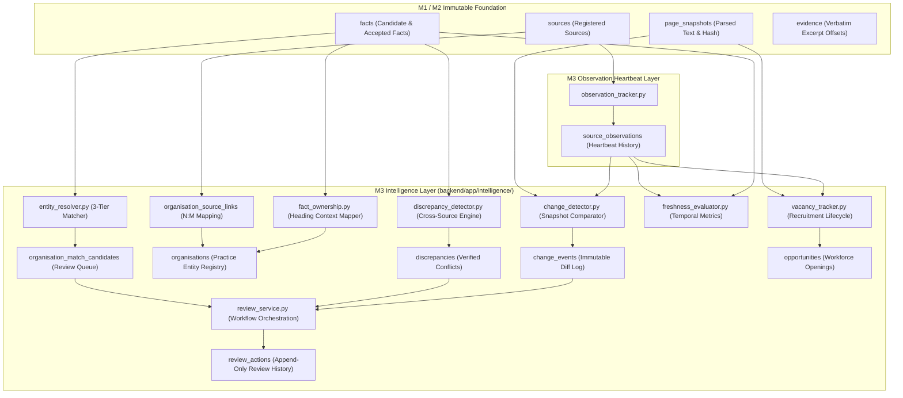
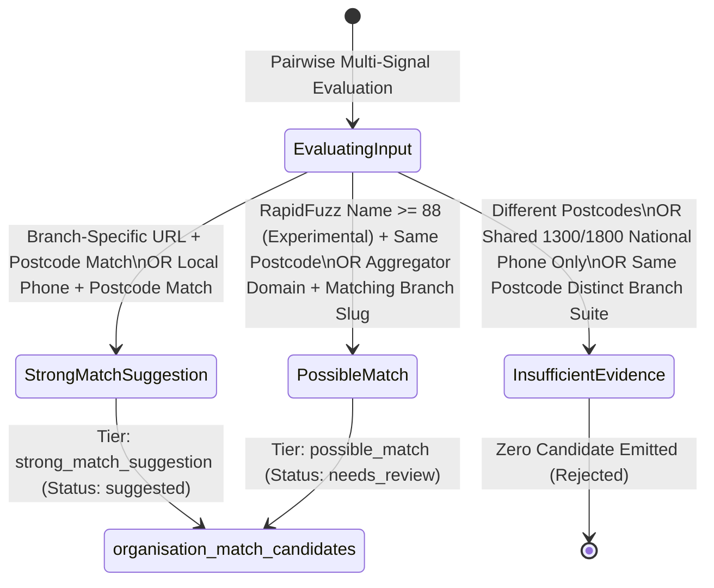
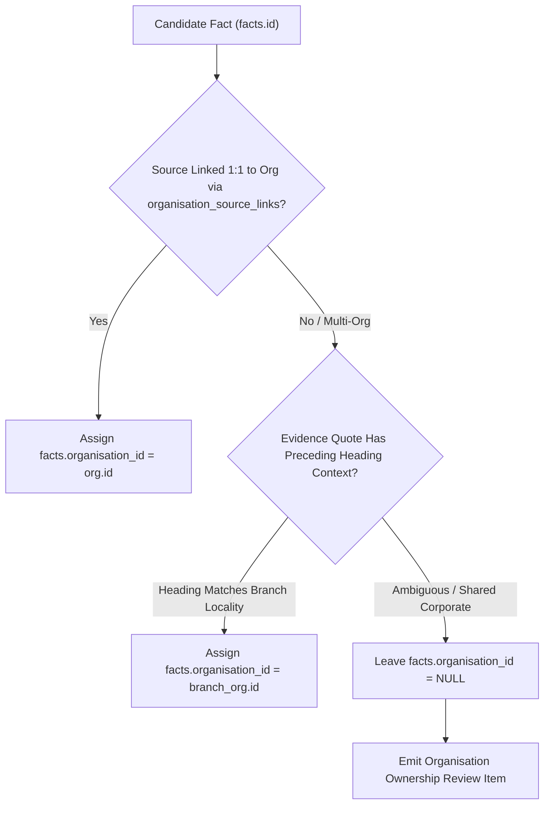
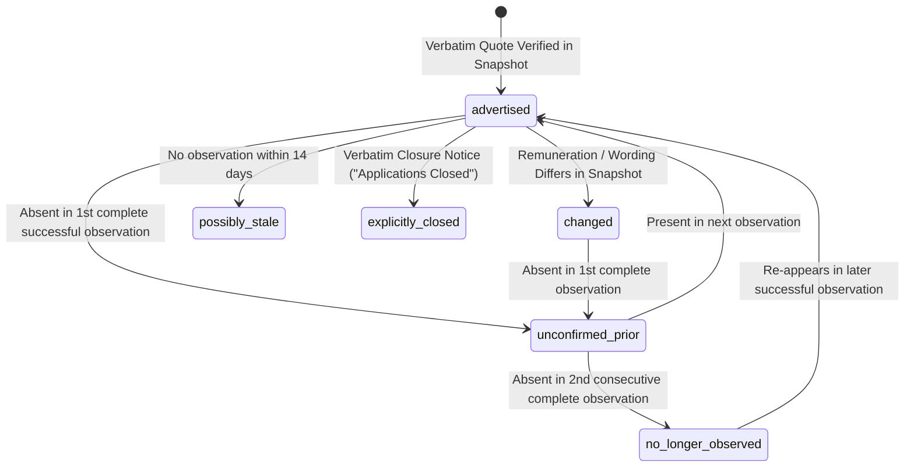

# PracticeSignal — Milestone 3 Architecture Proposal: Business Intelligence, Entity Resolution & Change Detection
## Revision 3 (Final Principal Systems Refinement)

> **Document Type:** Principal Systems Architecture & Technical Design Proposal
> **Milestone:** M3 (Business Intelligence, Entity Resolution & Change Detection)
> **Status:** Proposed for Architectural Review (Revision 3 — Architecture Specification Only; No application implementation)
> **Prepared:** 6 November 2026
> **Baseline Checkpoint Commit:** `6741e90` (`M2: complete audit remediation and strengthen evidence verification`, 67/67 pytest green, tsc clean, vite build clean)
> **Governing Decision Log:** Preserves approved decisions D1–D38; introduces proposed decisions D39–D47.

---

## 1. Executive Architecture Summary

Milestone 3 shifts PracticeSignal from isolated per-page extraction (M2) into an evidence-backed Healthcare Business Intelligence system.

While M2 established: *"What candidate facts can be extracted from this isolated HTML snapshot, and what exact text offsets prove them?"*
M3 answers: *"How do these verified facts aggregate across multiple public sources to model healthcare practice organisations, track temporal changes over time, detect cross-source discrepancies, monitor workforce recruitment vacancies, and maintain an immutable human review audit trail?"*

### Core Architectural Tenets (Revision 3 Refinements):
1. **Source Observation History as Currency Anchor:** Ingestion short-circuiting in M1 prevents creating duplicate `page_snapshots` when page content is unchanged. An additive `source_observations` table records every observation attempt (whether a new snapshot was persisted, content was unchanged, or ingestion failed) without mutating immutable snapshots. This provides the temporal foundation for data freshness and consecutive missing-observation tracking.
2. **Conservative Entity Resolution with Rigorous Score Semantics (D39):** Raw similarity scores (e.g. RapidFuzz token-sort 88/100) are explicitly separated from probability claims. The system emits discrete qualitative matching tiers: `strong_match_suggestion`, `possible_match`, and `insufficient_evidence`. Merges require human review; **zero auto-merges occur**.
3. **Deterministic Fact-to-Organisation Ownership:** Single-practice sources map facts directly. Multi-practice and corporate aggregator pages determine ownership via URL path scope and snapshot heading context. Ambiguous contexts leave `facts.organisation_id` as `NULL` and generate a review item; organisation ownership is **never** inferred solely through parent domain.
4. **Hierarchical Vacancy Identity & Conservative Lifecycle (D43):** Vacancies are identified by priority: explicit job ID $\to$ stable source URL slug $\to$ composite tuple (org + role + location). Missing vacancies require $\ge 2$ consecutive successful complete observations before transitioning to `no_longer_observed`. Status `filled` is strictly forbidden.
5. **Locally Identified Reviewer & Application-Level Immutability (D44):** The local prototype uses the term *locally identified reviewer*. The SQLite audit trail is transparently documented as application-level append-only history (not cryptographically tamper-proof against raw disk modifications).

---

## 2. Component Architecture & Single-Owner Modules

All M3 intelligence capabilities reside within a dedicated, isolated package: `backend/app/intelligence/`.

```
backend/app/intelligence/
├── __init__.py
├── schemas.py              # Pydantic v2 domain models for M3 entities & contracts
├── observation_tracker.py  # Source observation history & ingestion heartbeat engine
├── entity_resolver.py       # Conservative multi-signal matching & branch isolation
├── fact_ownership.py       # Heading-context & path-scoped fact-to-organisation mapper
├── discrepancy_detector.py  # Evidence-backed cross-source factual comparison
├── change_detector.py       # Temporal snapshot diffing & consecutive omission engine
├── freshness_evaluator.py   # Category-specific observation age & reliability metrics
├── vacancy_tracker.py       # Multi-attribute vacancy identity & conservative lifecycle
└── review_service.py        # Locally identified reviewer orchestration & audit trail
```

### Module Responsibilities & System Boundaries



---

## 3. Detailed Intelligence Capabilities (Revision 3 Refined)

### Capability A: Source Observation History & Temporal Heartbeat

#### 1. Ingestion Short-Circuiting and the Need for `source_observations`:
In M1, `backend/app/ingest/snapshot_store.py` hashes parsed text using SHA-256 (`content_hash`). If content is unchanged:
```python
existing = find_snapshot_by_hash(session, source.id, hash_)
if existing is not None:
    return existing, IngestOutcome(snapshot_id=existing.id, unchanged=True, ...)
```
When content does not change, **no new `PageSnapshot` is created**. The existing row keeps its original `fetched_at` timestamp.
Consequently, querying `page_snapshots.fetched_at` alone makes an unchanged website appear unobserved and stale, even if successfully checked daily. Furthermore, tracking consecutive observations where a fact is missing requires knowing every successful crawl attempt.

#### 2. The Additive `source_observations` Solution:
Introduced in sub-milestone M3.1, `source_observations` records every ingestion attempt:
- `source_id`: The source observed.
- `observed_at`: Exact UTC timestamp of the observation.
- `outcome`: `success_new_snapshot` (content changed), `success_unchanged` (hash matched existing snapshot), `failed` (network/policy error), `incomplete` (parser warning/truncation).
- `snapshot_id`: Nullable integer referencing the current active snapshot.
- `content_hash`: Hash of the parsed content.
- `content_changed`: Boolean flag.
- `parsing_completeness`: JSON summary of extracted headings and character count.
- `observation_sequence`: Monotonically increasing sequence number per source.
- `error_details`: Error message or policy rejection code if failed.

**Guarantees:**
- An unchanged observation records a `success_unchanged` entry without altering the immutable snapshot.
- A failed observation logs an error and **never** triggers change events or increments consecutive missing counters.
- Freshness is calculated from the latest `success_*` entry in `source_observations`.

---

### Capability B: Healthcare Organisation Matching & Score Semantics

#### 1. Distinguishing Similarity Scores from Probability Claims:
Presenting a string similarity metric (e.g. RapidFuzz token-sort score 88) as an "88% probability of identity" is statistically invalid without empirical Bayesian calibration on large production corpora.

PracticeSignal strictly distinguishes:
- **Raw Metric Score:** The deterministic string similarity metric (e.g. RapidFuzz token ratio `88/100`).
- **Evidence Signals:** Concrete factual boolean flags (e.g. `domain_match`, `postcode_match`, `local_phone_match`, `shared_corporate_phone`).
- **Matching Tier:** Discrete qualitative evaluation (`strong_match_suggestion`, `possible_match`, `insufficient_evidence`).
- **Human Review Status:** Review state (`suggested`, `needs_review`, `approved`, `rejected`).
- **Calibrated Probability:** Explicitly marked as *Not Available / Uncalibrated* in prototype.

#### 2. The Three Matching Tiers:



1. **`strong_match_suggestion`:**
   - Supported by **branch-level identity evidence**, never parent domain alone:
     - Exact local practice telephone (E.164, excluding 1300/1800 shared prefixes) AND identical 4-digit postcode; OR
     - Exact official domain (non-aggregator) AND identical 4-digit postcode AND matching suburb/state.
   - Emitted to `organisation_match_candidates` with status `suggested`.
2. **`possible_match`:**
   - RapidFuzz name ratio $\ge 88$ (experimental) AND identical postcode; OR
   - Shared aggregator domain with matching branch slug AND street address match where telephone is absent.
   - Emitted to `organisation_match_candidates` with status `needs_review`.
3. **`insufficient_evidence`:**
   - Shared brand name across different postcodes (F9 lookalike branches: Box Hill `3128` vs Frankston `3199`);
   - Same corporate domain and same postcode but distinct branch practices (e.g. Suite 1 Cardiology vs Suite 2 General Practice);
   - Shared national 1300/1800 call center numbers without matching local street address;
   - Generic clinic names ("Medical Practice") without address match.
   - **Zero match candidate is emitted.** All merging remains under human control.

---

### Capability C: Fact-to-Organisation Ownership Resolution

#### 1. The Multi-Practice Page Challenge:
A registered source may be a corporate portal or multi-clinic directory (e.g. `metrohealth.example.org/locations`) listing multiple branch clinics on a single page. If facts are assigned solely via source URL or parent domain, facts belonging to Box Hill become erroneously mixed with Frankston.

#### 2. Deterministic Mapping Hierarchy:
Fact ownership is resolved via `backend/app/intelligence/fact_ownership.py` using the smallest migration-safe solution: reusing the existing nullable `facts.organisation_id` column.



1. **Single Supported Practice:** If `organisation_source_links` maps the source $1:1$ to an organisation with `relationship_type = 'official_practice_site'`, all facts extracted from that source inherit `facts.organisation_id = org.id`.
2. **Multi-Practice & Corporate Pages:**
   - The engine inspects the evidence quote's nearest preceding heading from `page_snapshots.headings` (e.g. `(level=2, text="Box Hill Clinic Hours", start=120, end=142)`).
   - If the heading text matches a linked organisation's suburb, postcode, or branch slug, `facts.organisation_id` is deterministically populated with that branch's `organisation_id`.
3. **Ambiguous or Corporate-Wide Facts:**
   - If heading context is ambiguous (e.g. "General Enquiries", "About Us") or matches multiple branches, ownership is left **unresolved** (`facts.organisation_id = NULL`).
   - An ownership review item is created in `review_actions` for human assignment. Facts are **never** assigned solely through domain matching.

---

### Capability D: Evidence-Backed Cross-Source Discrepancy Detection

#### 1. Scope Compatibility Enforcement:
A factual comparison between two sources linked to the same organisation is valid **if and only if**:
$$\text{Comp}(F_a, F_b) \iff (\text{field\_key}_a = \text{field\_key}_b) \land (\text{scope\_key}_a = \text{scope\_key}_b) \land (\text{scope\_key}_a \neq \text{unknown})$$

- **NULL Scope Discipline:** A `NULL` scope key must **never** compare equal to another `NULL` scope key. Unknown scopes route to `needs_review`.
- **Departmental Scope Isolation:** Opening hours for `scope: clinic` (08:00–18:00) versus `scope: pathology` (07:30–12:00) represent valid departmental differentiation, **never** a discrepancy.
- **Candidate Quality Gate:** Candidate facts that are `rejected` or failed deterministic evidence verification cannot participate in discrepancy detection. Only `accepted` (evidence-verified) facts can be compared.

#### 2. Field-Specific Normalization:
- **Phone Numbers:** Normalized to E.164 (`+61394198888`). Differing formatting (`(03) 9419 8888` vs `0394198888`) evaluates as identical (Zero discrepancy).
- **Email Addresses:** Lowercased and whitespace-trimmed.
- **Websites:** Normalized scheme, host lowercased, trailing slash stripped, tracking query parameters removed.
- **Addresses:** Street abbreviations normalized (St, Rd, Ave, Blvd) and postcodes matched.

---

### Capability E: Healthcare Vacancy Identity & Lifecycle Tracking

#### 1. Vacancy Identity Priority:
To prevent duplicate opportunities when wording or job titles fluctuate, vacancy identity is resolved using a strict priority hierarchy:
1. **Explicit Published Vacancy / Job Reference ID:** (e.g. `Ref: GP-2026-04`).
2. **Stable Source-Local Identifier:** (e.g. specific job URL slug `/careers/vr-gp-melbourne`).
3. **Composite Identity Tuple:** `hash(organisation_id + role_category + location_slug + source_id)`.
4. **Conservative Candidate Matching:** When identity is uncertain, flag for human review rather than spawning a duplicate.

#### 2. Precise Lifecycle State Transitions:



- **Observation 1 Absent:** When a vacancy is absent from a complete successful observation, it transitions internally to `unconfirmed_prior`. It remains visible to recruiters as active (unconfirmed).
- **Observation 2 Absent:** After the **second consecutive complete successful observation** where the vacancy is absent, it transitions to `no_longer_observed`.
- **Failed / Incomplete Crawls:** If an observation fails (network error, policy block, parser truncation), the consecutive missing counter is **frozen**. Failed crawls never alter vacancy status.
- **Reappearing Vacancy:** If a previously unobserved vacancy appears again in a later successful observation, it transitions back to `advertised` with an updated `last_seen_at` and a logged `change_events` row.
- **Zero "Filled" Claims:** Missing vacancies are never marked `filled` or `hired`. Status `explicitly_closed` strictly requires verified verbatim closure evidence.

---

### Capability F: Human Review Workflow & Terminology Discipline

1. **Locally Identified Reviewer:** In the prototype implementation, reviewers are identified via the parameter `reviewer: str` (e.g. `"local_analyst_1"`). The system does not claim external enterprise authentication or SSO.
2. **Application-Level Append-Only Audit Trail:** All human decisions write immutable records to `review_actions` (`id`, `entity_type`, `entity_id`, `action`, `previous_status`, `new_status`, `reason_code`, `reviewer`, `notes`, `created_at`).
3. **Honest Security Posture:** The local SQLite review log is application-level append-only (zero update/delete endpoints in application code). It is explicitly acknowledged as non-cryptographic (it does not claim tamper-resistance against raw disk modifications).

---

## 4. Proposed Technical Architecture Decisions (D39–D47)

| Decision ID | Status | Proposed Architecture Decision | Rationale & Alternatives Considered |
|---|---|---|---|
| **D39 (Rev 3)** | Proposed | **Conservative 3-Tier Matching with Discrete Score Semantics.** Reject raw similarity scores as probabilities. Discrete tiers: `strong_match_suggestion` (branch-level identity evidence + postcode), `possible_match` (RapidFuzz $\ge 88$ experimental + postcode), `insufficient_evidence` (different postcodes, shared 1300 numbers, same-postcode distinct suites). **Zero auto-merges.** | *Why:* Eliminates false certainty and prevents merging distinct branches sharing brand names. *Alternative Rejected:* Probabilistic clustering or root-domain matching. |
| **D40 (Rev 3)** | Proposed | **Additive 8-Table Schema with Decoupled Observation Heartbeat.** Introduce `organisations`, `organisation_source_links`, `source_observations`, `organisation_match_candidates`, `discrepancies`, `change_events`, `opportunities`, `review_actions`. Existing tables remain 100% untouched. | *Why:* Avoids risky SQLite table recreations while solving observation history for unchanged snapshots. *Alternative Rejected:* Mutating `page_snapshots` or `sources`. |
| **D41 (Rev 3)** | Proposed | **Scope Compatibility Gated Discrepancy Detection.** Cross-source comparison strictly requires matching `organisation_id`, `field_key`, and matching `scope_key`. NULL scopes do not equal NULL scopes. Only evidence-verified `accepted` facts participate. | *Why:* Eliminates departmental false-positive conflicts (clinic vs pathology hours). *Alternative Rejected:* Cross-scope heuristic diffing. |
| **D42 (Rev 3)** | Proposed | **DOM Verification & 2-Crawl Rule for Change Events.** Change engine requires successful complete observation from `source_observations`. LLM extraction omissions are verified against DOM text to suppress false removals. Facts absent across $\ge 2$ consecutive crawls emit `fact_unobserved`. | *Why:* Distinguishes parser/LLM extraction omissions from real-world content deletions. *Alternative Rejected:* Single-crawl deletion alerts. |
| **D43 (Rev 3)** | Proposed | **Priority-Based Vacancy Identity & Conservative Lifecycle.** Identity prioritized: explicit Job ID $\to$ stable source slug $\to$ composite tuple. Transitions: `advertised`, `changed`, `possibly_stale`, `unconfirmed_prior`, `no_longer_observed`, `explicitly_closed`. **Zero "filled" inferences.** | *Why:* Ad removal does not prove hiring success. Title diffs update existing opportunity without duplicate creation. *Alternative Rejected:* Binary open/closed status. |
| **D44 (Rev 3)** | Proposed | **Locally Identified Reviewer & Application Append-Only Audit.** Human review decisions write immutable records to `review_actions`. Honest disclosure: local SQLite log is application append-only, not cryptographically tamper-proof against raw disk edits. | *Why:* Complete decision provenance without overclaiming enterprise cryptographic security. *Alternative Rejected:* Silent in-place status updates. |
| **D45 (Rev 3)** | Proposed | **Expanded Synthetic Multi-Source Corpus (F7–F14).** Existing F1–F6 frozen. F7–F14 test observation short-circuiting, failed crawls, extraction omissions, branch lookalikes, multi-branch page heading context, and vacancy lifecycles. Zero live scraping. | *Why:* Reproducible, verifiable, zero-cost intelligence testing. *Alternative Rejected:* Scraping live directory pages. |
| **D46 (Rev 3)** | Proposed | **Category-Specific Freshness Gated by Source Observations.** Four distinct timestamps (`observed_at`, `published_at`, `updated_at`, `verified_at`). Configurable thresholds (14d vacancies, 30d hours, 90d addresses). Freshness derived from `source_observations.observed_at`. Injected reference clock in tests. | *Why:* Eliminates wall-clock flakiness and prevents unchanged snapshots from appearing stale. *Alternative Rejected:* Universal hardcoded 30-day timer. |
| **D47 (New)** | Proposed | **Deterministic Fact Ownership via Heading Context & Scoped Paths.** Map facts to organisations using source link, URL path scope, and snapshot heading context. Reuses existing `facts.organisation_id` nullable column. Ambiguous context leaves `organisation_id = NULL` for human review. | *Why:* Smallest migration-safe solution for multi-practice pages without schema alteration. *Alternative Rejected:* Adding a new `fact_organisations` linking table. |
