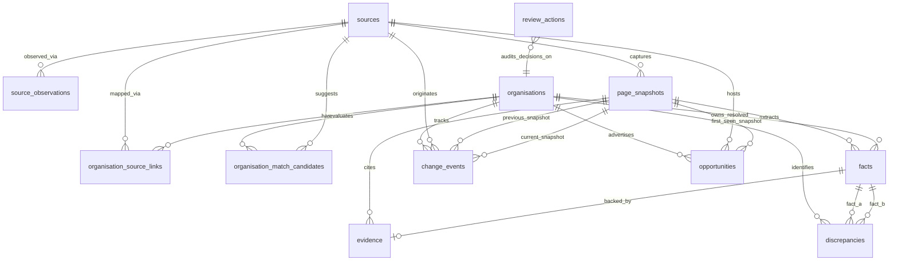

# PracticeSignal — Milestone 3 Data Model: Healthcare Intelligence, Provenance & Audit Schema
## Revision 3 (Final Principal Systems Refinement)

> **Document Type:** Database Schema Architecture & Entity Relationship Specification
> **Milestone:** M3 (Business Intelligence, Entity Resolution & Change Detection)
> **Status:** Proposed Schema Design (Revision 3 — Architecture Specification Only; No migrations or ORM edits applied)
> **Prepared:** 6 November 2026
> **Baseline Checkpoint Commit:** `6741e90`
> **Database Engine:** SQLite 3 (WAL mode enabled via `PRAGMA journal_mode=WAL; PRAGMA foreign_keys=ON;`)

---

## 1. Definitive Database Inventory & Relationship Architecture

Milestone 3 introduces **eight additive database tables** to support multi-source business intelligence, observation heartbeats, corporate-to-branch hierarchies, temporal diffing, and auditability without modifying existing M0–M2 tables.

### Definitive Table Count & Inventory:

| Table Name | Milestone Phase | Category | Primary Purpose | Existing Tables Touched |
|---|---|---|---|---|
| `organisations` | M3.1 | Registry | Canonical healthcare practice entity registry | None (New table) |
| `organisation_source_links` | M3.1 | Relational Link | Additive N:M mapping between organisations and sources with path scoping | None (New table) |
| `source_observations` | M3.1 | Heartbeat | Complete history of observation attempts (capturing unchanged crawls and failures) | None (New table) |
| `organisation_match_candidates` | M3.1 | Staging Queue | Conservative entity resolution match suggestions (Zero auto-merge) | None (New table) |
| `discrepancies` | M3.2 | Intelligence | Evidence-backed factual conflicts between sources on matching scope | None (New table) |
| `change_events` | M3.3 | Temporal Diff | Immutable, append-only log of snapshot fact diffs | None (New table) |
| `opportunities` | M3.5 | Entity | Healthcare workforce recruitment openings & lifecycles | None (New table) |
| `review_actions` | M3.6 | Audit Trail | Application-level append-only human review decision log | None (New table) |

---

## 2. Resolving Fact Ownership & Observation Heartbeats

### 1. The Observation Heartbeat Problem:
In M1, `backend/app/ingest/snapshot_store.py` short-circuits unchanged page snapshots using `content_hash`. When a source is re-crawled and content has not changed, **no new `PageSnapshot` is created**. The immutable snapshot keeps its original `fetched_at` timestamp.
Consequently, relying on `page_snapshots.fetched_at` alone makes an unchanged website appear unobserved and stale, even if crawled daily. Furthermore, determining whether a fact has been absent across two consecutive observations requires knowing every successful crawl attempt.

**The Solution (`source_observations`):**
- Records every ingestion attempt with outcome: `success_new_snapshot`, `success_unchanged`, `failed`, or `incomplete`.
- An unchanged observation records `success_unchanged` without modifying the immutable `page_snapshots` row.
- A failed observation is recorded with error details and **never** increments consecutive missing counters or generates change events.
- Freshness calculations query the latest `success_*` timestamp from `source_observations`.

### 2. Smallest Migration-Safe Fact Ownership Resolution:
Inspection of `backend/app/db/orm.py` and `facts` schema reveals:
`organisation_id: Mapped[int | None] = mapped_column(Integer, nullable=True)`
The column already exists as an unconstrained, nullable integer. Creating an additional linking table between facts and organisations would introduce unnecessary complexity and join overhead.
- When a source is linked 1:1 to an organisation, extracted facts inherit `facts.organisation_id = org.id`.
- For multi-branch or corporate pages, ownership is resolved deterministically using the quote's preceding heading from `page_snapshots.headings`.
- If heading context is ambiguous, `facts.organisation_id` remains `NULL`, and a review item is created.
- This requires **zero alterations** to the `facts` table schema, ensuring 100% migration safety.

---

## 3. Entity-Relationship Diagram (ERD)



---

## 4. Formal SQLite Table Definitions (DDL)

### 1. `organisations` Table (Canonical Practice Entity)

```sql
CREATE TABLE organisations (
    id INTEGER PRIMARY KEY AUTOINCREMENT,
    name VARCHAR(255) NOT NULL,
    slug VARCHAR(255) NOT NULL UNIQUE,
    primary_domain VARCHAR(255),
    corporate_parent_id INTEGER REFERENCES organisations(id) ON DELETE SET NULL,
    phone VARCHAR(32),
    address VARCHAR(512),
    suburb VARCHAR(128),
    postcode VARCHAR(16) NOT NULL,
    state VARCHAR(16) NOT NULL,
    status VARCHAR(32) NOT NULL DEFAULT 'active', -- active, inactive, pending_review, merged
    created_at DATETIME NOT NULL DEFAULT CURRENT_TIMESTAMP,
    updated_at DATETIME NOT NULL DEFAULT CURRENT_TIMESTAMP
);

CREATE INDEX idx_org_domain ON organisations(primary_domain);
CREATE INDEX idx_org_phone ON organisations(phone);
CREATE INDEX idx_org_locality ON organisations(state, postcode, suburb);
CREATE INDEX idx_org_corporate ON organisations(corporate_parent_id);
```

### 2. `organisation_source_links` Table (N:M Source Mapping)

```sql
CREATE TABLE organisation_source_links (
    id INTEGER PRIMARY KEY AUTOINCREMENT,
    organisation_id INTEGER NOT NULL REFERENCES organisations(id) ON DELETE CASCADE,
    source_id INTEGER NOT NULL REFERENCES sources(id) ON DELETE CASCADE,
    relationship_type VARCHAR(64) NOT NULL, -- official_practice_site, corporate_parent, branch_page, third_party_directory
    scope_path VARCHAR(512),               -- subpath scoping (e.g. /clinics/box-hill)
    verification_status VARCHAR(32) NOT NULL DEFAULT 'suggested', -- suggested, confirmed, rejected
    verified_by VARCHAR(255),
    verified_at DATETIME,
    created_at DATETIME NOT NULL DEFAULT CURRENT_TIMESTAMP,
    UNIQUE(organisation_id, source_id, scope_path)
);

CREATE INDEX idx_org_src_link_org ON organisation_source_links(organisation_id);
CREATE INDEX idx_org_src_link_src ON organisation_source_links(source_id);
CREATE INDEX idx_org_src_link_status ON organisation_source_links(verification_status);
```

### 3. `source_observations` Table (Observation Heartbeat History)

```sql
CREATE TABLE source_observations (
    id INTEGER PRIMARY KEY AUTOINCREMENT,
    source_id INTEGER NOT NULL REFERENCES sources(id) ON DELETE CASCADE,
    observed_at DATETIME NOT NULL DEFAULT CURRENT_TIMESTAMP,
    outcome VARCHAR(32) NOT NULL,          -- success_new_snapshot, success_unchanged, failed, incomplete
    snapshot_id INTEGER REFERENCES page_snapshots(id) ON DELETE SET NULL,
    content_hash VARCHAR(64),
    content_changed BOOLEAN NOT NULL DEFAULT 0,
    parsing_completeness JSON,             -- {"headings_count": 8, "char_count": 3420}
    observation_sequence INTEGER NOT NULL, -- sequential counter per source
    error_details TEXT,
    created_at DATETIME NOT NULL DEFAULT CURRENT_TIMESTAMP
);

CREATE INDEX idx_obs_source_seq ON source_observations(source_id, observation_sequence);
CREATE INDEX idx_obs_source_date ON source_observations(source_id, observed_at);
CREATE INDEX idx_obs_outcome ON source_observations(outcome);
```

### 4. `organisation_match_candidates` Table (Conservative Match Queue)

```sql
CREATE TABLE organisation_match_candidates (
    id INTEGER PRIMARY KEY AUTOINCREMENT,
    source_id INTEGER NOT NULL REFERENCES sources(id) ON DELETE CASCADE,
    suggested_organisation_id INTEGER NOT NULL REFERENCES organisations(id) ON DELETE CASCADE,
    match_tier VARCHAR(32) NOT NULL,       -- strong_match_suggestion, possible_match, insufficient_evidence
    raw_metric_score REAL,                 -- e.g. RapidFuzz token ratio 88.0 (marked experimental)
    evidence_signals JSON NOT NULL,        -- {"domain_match": true, "postcode_match": true, "local_phone_match": true, "corporate_phone_detected": false}
    rationale TEXT NOT NULL,
    status VARCHAR(32) NOT NULL DEFAULT 'suggested', -- suggested, needs_review, approved, rejected
    reviewed_by VARCHAR(255),
    reviewed_at DATETIME,
    created_at DATETIME NOT NULL DEFAULT CURRENT_TIMESTAMP,
    UNIQUE(source_id, suggested_organisation_id)
);

CREATE INDEX idx_match_cand_org ON organisation_match_candidates(suggested_organisation_id);
CREATE INDEX idx_match_cand_status ON organisation_match_candidates(status);
CREATE INDEX idx_match_cand_tier ON organisation_match_candidates(match_tier);
```

### 5. `discrepancies` Table (Evidence-Backed Factual Conflicts)

```sql
CREATE TABLE discrepancies (
    id INTEGER PRIMARY KEY AUTOINCREMENT,
    organisation_id INTEGER NOT NULL REFERENCES organisations(id) ON DELETE CASCADE,
    field_key VARCHAR(64) NOT NULL,
    scope_key VARCHAR(64) NOT NULL,
    fact_a_id INTEGER NOT NULL REFERENCES facts(id) ON DELETE CASCADE,
    fact_b_id INTEGER NOT NULL REFERENCES facts(id) ON DELETE CASCADE,
    conflict_type VARCHAR(64) NOT NULL, -- value_mismatch, temporal_divergence, ambiguity
    status VARCHAR(32) NOT NULL DEFAULT 'detected', -- detected, resolved_fact_a, resolved_fact_b, dismissed_benign, needs_investigation
    resolution_notes TEXT,
    resolved_by VARCHAR(255),
    resolved_at DATETIME,
    created_at DATETIME NOT NULL DEFAULT CURRENT_TIMESTAMP,
    CHECK (fact_a_id != fact_b_id),
    UNIQUE(organisation_id, field_key, scope_key, fact_a_id, fact_b_id)
);

CREATE INDEX idx_discrepancy_org ON discrepancies(organisation_id);
CREATE INDEX idx_discrepancy_field_scope ON discrepancies(field_key, scope_key);
CREATE INDEX idx_discrepancy_status ON discrepancies(status);
```

### 6. `change_events` Table (Temporal Snapshot Fact Diffs)

```sql
CREATE TABLE change_events (
    id INTEGER PRIMARY KEY AUTOINCREMENT,
    source_id INTEGER NOT NULL REFERENCES sources(id) ON DELETE CASCADE,
    organisation_id INTEGER REFERENCES organisations(id) ON DELETE SET NULL,
    previous_snapshot_id INTEGER NOT NULL REFERENCES page_snapshots(id) ON DELETE CASCADE,
    current_snapshot_id INTEGER NOT NULL REFERENCES page_snapshots(id) ON DELETE CASCADE,
    event_type VARCHAR(64) NOT NULL, -- fact_added, fact_modified, fact_unobserved, fact_reappeared
    entity_type VARCHAR(32) NOT NULL, -- fact, opportunity
    entity_id INTEGER,
    field_key VARCHAR(64) NOT NULL,
    scope_key VARCHAR(64),
    old_value TEXT,
    new_value TEXT,
    diff_metadata JSON NOT NULL,     -- {"wording_diff": "+72% -70%", "omission_confirmed_in_dom": true}
    detected_at DATETIME NOT NULL DEFAULT CURRENT_TIMESTAMP,
    CHECK (previous_snapshot_id != current_snapshot_id)
);

CREATE INDEX idx_change_source ON change_events(source_id);
CREATE INDEX idx_change_org ON change_events(organisation_id);
CREATE INDEX idx_change_event_type ON change_events(event_type);
CREATE INDEX idx_change_detected ON change_events(detected_at);
```

### 7. `opportunities` Table (Healthcare Recruitment Openings)

```sql
CREATE TABLE opportunities (
    id INTEGER PRIMARY KEY AUTOINCREMENT,
    organisation_id INTEGER NOT NULL REFERENCES organisations(id) ON DELETE CASCADE,
    source_id INTEGER NOT NULL REFERENCES sources(id) ON DELETE CASCADE,
    first_snapshot_id INTEGER NOT NULL REFERENCES page_snapshots(id) ON DELETE CASCADE,
    last_snapshot_id INTEGER NOT NULL REFERENCES page_snapshots(id) ON DELETE CASCADE,
    role_category VARCHAR(64) NOT NULL,  -- gp, nurse, allied_health, administrative, specialist
    role_title VARCHAR(255) NOT NULL,
    verbatim_wording TEXT NOT NULL,
    contact_channel VARCHAR(255),
    explicit_ad_id VARCHAR(128),         -- published Job Reference ID if present
    status VARCHAR(32) NOT NULL DEFAULT 'advertised', -- advertised, changed, possibly_stale, unconfirmed_prior, no_longer_observed, explicitly_closed
    closure_evidence_quote TEXT,         -- required for status='explicitly_closed'
    first_seen_at DATETIME NOT NULL DEFAULT CURRENT_TIMESTAMP,
    last_seen_at DATETIME NOT NULL DEFAULT CURRENT_TIMESTAMP,
    closed_at DATETIME,
    created_at DATETIME NOT NULL DEFAULT CURRENT_TIMESTAMP,
    updated_at DATETIME NOT NULL DEFAULT CURRENT_TIMESTAMP
);

CREATE INDEX idx_opp_org ON opportunities(organisation_id);
CREATE INDEX idx_opp_role ON opportunities(role_category);
CREATE INDEX idx_opp_status ON opportunities(status);
CREATE INDEX idx_opp_ad_id ON opportunities(explicit_ad_id);
```

### 8. `review_actions` Table (Append-Only Decision History)

```sql
CREATE TABLE review_actions (
    id INTEGER PRIMARY KEY AUTOINCREMENT,
    entity_type VARCHAR(32) NOT NULL, -- match_candidate, discrepancy, change_event, opportunity, organisation, fact_ownership
    entity_id INTEGER NOT NULL,
    action VARCHAR(64) NOT NULL,      -- approved, rejected, resolved_a, resolved_b, dismissed_benign, assigned_org, reopened
    previous_status VARCHAR(32) NOT NULL,
    new_status VARCHAR(32) NOT NULL,
    reason_code VARCHAR(64) NOT NULL, -- verified_practice_domain, distinct_branch_clinic, departmental_hours_distinction, verbatim_closure_confirmed, heading_scope_confirmed
    reviewer VARCHAR(255) NOT NULL,   -- locally identified reviewer (e.g. "analyst_1")
    notes TEXT,
    created_at DATETIME NOT NULL DEFAULT CURRENT_TIMESTAMP
);

CREATE INDEX idx_review_entity ON review_actions(entity_type, entity_id);
CREATE INDEX idx_review_action ON review_actions(action);
CREATE INDEX idx_review_created ON review_actions(created_at);
```

---

## 5. Deletion Cascades & Data Preservation Rules

1. **Source Privacy Erasure (D8):**
   - Deleting a source cascades to delete its `page_snapshots`, `facts`, `evidence`, and `source_observations`.
   - `organisation_source_links` rows cascade (`ON DELETE CASCADE`).
   - `organisations` records are **NOT** deleted (`ON DELETE RESTRICT` from facts, discrepancies, and opportunities). An organisation created from multiple public sources survives the removal of an individual source.
2. **Review Action Preservation:**
   - `review_actions` stores `entity_type` and `entity_id` as unconstrained integer references without foreign key constraints, guaranteeing that audit history survives entity deletions.
3. **Immutability Guarantees:**
   - `source_observations`, `change_events`, and `review_actions` have zero `UPDATE` or `DELETE` API endpoints in application code.

---

## 6. Migration Sequencing & Safe SQLite Rebuilding

Migrations are strictly partitioned across milestones:

- **Migration M3_001 (Milestone M3.1):** `organisations`, `organisation_source_links`, `source_observations`, `organisation_match_candidates`.
- **Migration M3_002 (Milestone M3.2):** `discrepancies`.
- **Migration M3_003 (Milestone M3.3):** `change_events`.
- **Migration M3_004 (Milestone M3.5):** `opportunities`.
- **Migration M3_005 (Milestone M3.6):** `review_actions`.

Every migration step:
1. Executes an automated timestamped backup (`practicesignal.db.bak_YYYYMMDD_HHMMSS`).
2. Runs inside an atomic transaction (`BEGIN IMMEDIATE ... COMMIT`).
3. Executes `PRAGMA foreign_key_check` before committing.
4. Auto-recovers from backup on any error.
