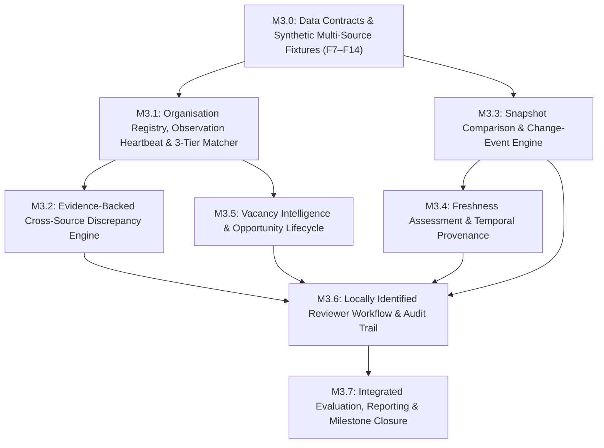

# PracticeSignal — Milestone 3 Implementation Plan: Business Intelligence, Entity Resolution & Change Detection
## Revision 3 (Final Principal Systems Refinement)

> **Document Type:** Principal Engineering Implementation Plan & Sub-Milestone Roadmap
> **Milestone:** M3 (Business Intelligence, Entity Resolution & Change Detection)
> **Status:** Proposed Implementation Roadmap (Revision 3 — Architecture Specification Only; No application implementation)
> **Prepared:** 6 November 2026
> **Baseline Checkpoint Commit:** `6741e90`
> **Governing Architecture Docs:** `docs/M3_ARCHITECTURE_PROPOSAL.md`, `docs/M3_DATA_MODEL.md`

---

## 1. Incremental Delivery Strategy & Phased Migrations

To eliminate big-bang migration risk and ensure early verification, Milestone 3 partitions database schema additions and capabilities across eight focused sub-milestones (**M3.0 to M3.7**).

### Delivery Principles:
1. **Zero Database Changes in M3.0:** M3.0 establishes data contracts (Pydantic & TypeScript) and synthetic multi-source fixtures without modifying the SQLite database.
2. **Incremental Migrations per Milestone:** Each database table is introduced exclusively in the sub-milestone where its business logic is implemented and tested.
3. **Observation Heartbeats Established Early (M3.1):** `source_observations` is introduced alongside `organisations` in M3.1 to record every ingestion attempt, capturing unchanged crawls without mutating immutable snapshots.
4. **Additive Schema Only:** No existing columns or tables in M0–M2 are altered. Reusing nullable `facts.organisation_id` avoids risky table recreations.
5. **Early Verifiable Vertical Slice (M3.0–M3.2):** Completing M3.0, M3.1, and M3.2 delivers a functional multi-source intelligence pipeline (Organisations -> Sources -> Observations -> Discrepancies) with verified evidence citations before tackling temporal snapshot diffing.

---

## 2. Sub-Milestone Implementation Sequence

---

## 3. Sub-Milestone Specifications & Acceptance Criteria

### M3.0 — Intelligence Data Contracts & Synthetic Multi-Source Fixtures

- **Objective:** Establish the Pydantic v2 domain schemas, TypeScript type definitions, and multi-source synthetic test corpus (F7–F14) required for all subsequent M3 development.
- **Dependencies:** M2 baseline (`6741e90`).
- **Database Schema Changes:** **NONE.**
- **Components & Files Involved:**
  - `backend/app/intelligence/schemas.py`: Pydantic models for Organisation, OrganisationSourceLink, SourceObservation, MatchCandidate, Discrepancy, ChangeEvent, Opportunity, ReviewAction.
  - `frontend/src/types/intelligence.ts`: TypeScript mirrors of all schemas.
  - `backend/tests/fixtures/m3_corpus/`: Synthetic test fixtures:
    - `group_alpha_matching/`: F7 (exact domain), F8 (name variation), F9 (branch clinic lookalike, different postcode), F9_neg (generic clinic name), F9_precinct (same corporate domain and same postcode but distinct suites).
    - `group_beta_discrepancy/`: F10 (corroborating phone), F11 (conflicting phone), F12 (clinic vs pathology hours scope isolation), F12_null (unscoped hours).
    - `group_gamma_changes/`: F13_v1 (baseline), F13_v2 (modified phone, added service), F13_v3 (omitted service, reappeared phone), F13_err (crawl error).
    - `group_delta_vacancies/`: F14_v1 (new GP ad), F14_v2 (wording/title change), F14_v3a (disappearance across crawls), F14_v3b (explicit closure notice).
- **Tests to Introduce:**
  - `backend/tests/test_m3_contracts.py`: Validate Pydantic schema serialization/deserialization and enum validations.
  - `backend/tests/test_m3_fixtures_integrity.py`: Validate all fixtures contain required synthetic headers, `.example.org` domains, and ground-truth metadata.
- **Acceptance Criteria (M3-AC-0):**
  - [ ] All Pydantic models validate successfully with strict type enforcement.
  - [ ] Frontend `npm run typecheck` passes with zero errors on imported intelligence types.
  - [ ] All synthetic fixtures clearly declare fictional practice names and non-routable domains.
  - [ ] Accompanied by ground-truth expectation files (`expectations_*.json`).

---

### M3.1 — Organisation Registry, Observation Heartbeat & 3-Tier Entity Matching

- **Objective:** Implement the healthcare practice organization registry, source mapping via `organisation_source_links`, observation heartbeat via `source_observations`, heading-based fact ownership, and the conservative 3-tier entity matching engine.
- **Dependencies:** M3.0.
- **Database Changes (Migration M3_001):**
  - Create table `organisations` (`id`, `name`, `slug`, `primary_domain`, `corporate_parent_id`, `phone`, `address`, `suburb`, `postcode`, `state`, `status`, `created_at`, `updated_at`).
  - Create table `organisation_source_links` (`id`, `organisation_id`, `source_id`, `relationship_type`, `scope_path`, `verification_status`, `verified_by`, `verified_at`, `created_at`).
  - Create table `source_observations` (`id`, `source_id`, `observed_at`, `outcome`, `snapshot_id`, `content_hash`, `content_changed`, `parsing_completeness`, `observation_sequence`, `error_details`, `created_at`).
  - Create table `organisation_match_candidates` (`id`, `source_id`, `suggested_organisation_id`, `match_tier`, `raw_metric_score`, `evidence_signals`, `rationale`, `status`, `reviewed_by`, `reviewed_at`, `created_at`).
  - Indexes: `idx_org_domain`, `idx_org_locality`, `idx_org_src_link_org`, `idx_obs_source_seq`, `idx_match_cand_org`, `idx_match_cand_tier`.
- **Components & Files Involved:**
  - `backend/app/db/orm.py`: Add `Organisation`, `OrganisationSourceLink`, `SourceObservation`, `OrganisationMatchCandidate` ORM models.
  - `backend/app/db/migrations.py`: Add `migrate_m3_001_organisations_observations_and_links(db_path)`.
  - `backend/app/intelligence/observation_tracker.py`: Records observation attempts, captures unchanged short-circuits (`success_unchanged`), and tracks observation sequences.
  - `backend/app/intelligence/fact_ownership.py`: Resolves fact ownership using source links and snapshot heading context; leaves ambiguous facts as `NULL`.
  - `backend/app/intelligence/entity_resolver.py`: Evaluates 3-tier matching rules (`strong_match_suggestion`, `possible_match`, `insufficient_evidence`) without claiming uncalibrated probabilities.
  - `backend/app/api/organisations.py`: REST endpoints for practice directory and match review queue.
- **Tests to Introduce:**
  - `test_unchanged_observation_records_heartbeat_without_new_snapshot`: Crawling unchanged content inserts `source_observations(outcome='success_unchanged')` without adding a new row to `page_snapshots`.
  - `test_failed_observation_records_error_outcome`: Ingestion error records `outcome='failed'` and leaves snapshot sequence unchanged.
  - `test_fact_ownership_by_heading_context_on_multibranch_page`: Resolves facts under "Box Hill Clinic" heading to Box Hill organisation and leaves general facts as `NULL`.
  - `test_lookalike_branch_strict_rejection`: Asserts "Metropolitan Medical Box Hill" (3128) vs "Metropolitan Medical Frankston" (3199) emits ZERO match candidates.
  - `test_same_postcode_distinct_suite_insufficient_evidence`: Rejects matching distinct specialties sharing a corporate host and postcode.
- **Acceptance Criteria (M3-AC-1):**
  - [ ] Migration M3_001 applies cleanly on SQLite database with automated backup.
  - [ ] Existing M0–M2 tables (`sources`, `page_snapshots`, `facts`, etc.) remain 100% unaltered.
  - [ ] Unchanged crawls record observation heartbeats without modifying snapshots.
  - [ ] Zero automatic merges occur: all suggestions require human review.
  - [ ] 100% of branch lookalike test pairs (F9) are rejected without match candidates.

---

### M3.2 — Evidence-Backed Cross-Source Discrepancy Detection

- **Objective:** Detect and persist evidence-backed factual discrepancies between independent sources linked to the same practice organisation, strictly enforcing scope compatibility.
- **Dependencies:** M3.1.
- **Database Changes (Migration M3_002):**
  - Create table `discrepancies` (`id`, `organisation_id`, `field_key`, `scope_key`, `fact_a_id`, `fact_b_id`, `conflict_type`, `status`, `resolution_notes`, `resolved_by`, `resolved_at`, `created_at`).
  - Indexes: `idx_discrepancy_org`, `idx_discrepancy_field_scope`, `idx_discrepancy_status`.
- **Components & Files Involved:**
  - `backend/app/db/orm.py`: Add `Discrepancy` ORM model.
  - `backend/app/db/migrations.py`: Add `migrate_m3_002_discrepancies(db_path)`.
  - `backend/app/intelligence/discrepancy_detector.py`: Cross-source factual comparison engine.
  - `backend/app/api/discrepancies.py`: Discrepancy listing and review endpoints.
- **Tests to Introduce:**
  - `test_phone_discrepancy_same_scope`: Flags genuine conflicting telephone numbers for general reception.
  - `test_phone_formatting_normalization_no_discrepancy`: `(03) 9419 8888` vs `0394198888` normalizes to identical E.164 and raises no discrepancy.
  - `test_clinic_vs_pathology_hours_scope_isolation`: Asserts Clinic Hours (08:00–18:00) vs Pathology Hours (07:30–12:00) does NOT raise a discrepancy.
  - `test_null_scope_does_not_equal_null_scope`: Unscoped facts route to `needs_review` rather than auto-conflict.
  - `test_unverified_candidate_facts_excluded`: Asserts candidate facts with status `rejected` or `needs_review` cannot trigger discrepancies.
- **Acceptance Criteria (M3-AC-2):**
  - [ ] Every detected discrepancy links to two verified `accepted` facts with valid evidence quotes.
  - [ ] Scope mismatches (e.g. `pathology` vs `clinic`) are rejected with 0 false discrepancies.
  - [ ] Synthetic discrepancy corpus F10–F12 passes with 100% precision.

---

### M3.3 — Snapshot Comparison & Change-Event Generation

- **Objective:** Compare successive page snapshots of the same source over time to generate granular, immutable `change_events`, separating LLM extraction omissions from real-world content removals using DOM text verification.
- **Dependencies:** M3.0, M3.1.
- **Database Changes (Migration M3_003):**
  - Create table `change_events` (`id`, `source_id`, `organisation_id`, `previous_snapshot_id`, `current_snapshot_id`, `event_type`, `entity_type`, `entity_id`, `field_key`, `scope_key`, `old_value`, `new_value`, `diff_metadata`, `detected_at`).
  - Indexes: `idx_change_source`, `idx_change_org`, `idx_change_event_type`, `idx_change_detected`.
- **Components & Files Involved:**
  - `backend/app/db/orm.py`: Add `ChangeEvent` ORM model.
  - `backend/app/db/migrations.py`: Add `migrate_m3_003_change_events(db_path)`.
  - `backend/app/intelligence/change_detector.py`: Temporal snapshot comparator and DOM diff verifier.
  - `backend/app/api/changes.py`: Chronological intelligence change feed REST endpoints.
- **Tests to Introduce:**
  - `test_fact_added_on_new_service`: Detects newly introduced physiotherapy service in snapshot v2.
  - `test_fact_modified_on_phone_change`: Records old phone and new phone with exact JSON diff metadata.
  - `test_extraction_omission_verified_in_dom_emits_no_removal`: If text still contains fact value, flags extraction omission and suppresses removal event.
  - `test_fact_unobserved_after_two_successful_crawls`: Confirms fact absent across $\ge 2$ consecutive successful complete observations transitions to `fact_unobserved`.
  - `test_failed_observation_freezes_sequence`: Asserts that an observation failure does not increment consecutive missing counters.
- **Acceptance Criteria (M3-AC-3):**
  - [ ] Every change event preserves foreign keys to both snapshots.
  - [ ] Failed or incomplete observations never trigger unobserved events.
  - [ ] Synthetic change corpus F13 passes all transition checks.

---

### M3.4 — Information Freshness & Temporal Provenance

- **Objective:** Compute transparent freshness and reliability metrics for every stored fact, separating observation time from publication and confirmation timestamps.
- **Dependencies:** M3.1, M3.3.
- **Database Changes:** **NONE** (Calculated dynamically using `source_observations.observed_at` and category thresholds).
- **Components & Files Involved:**
  - `backend/app/intelligence/freshness_evaluator.py`: Freshness engine computing observation age, confirmation status, and staleness categories (`fresh`, `aging`, `stale`, `unconfirmed_prior`).
  - `backend/app/api/freshness.py`: Freshness metrics query endpoints.
- **Tests to Introduce:**
  - `test_fresh_status_derived_from_source_observations`: Validates freshness reflects latest successful crawl, even if snapshot content was unchanged.
  - `test_category_specific_freshness_thresholds`: Asserts vacancies use 14d, hours use 30d, address uses 90d.
  - `test_injected_reference_clock`: Evaluates temporal transitions deterministically using an injected frozen clock.
- **Acceptance Criteria (M3-AC-4):**
  - [ ] Unchanged snapshots are correctly evaluated as fresh if observed recently in `source_observations`.
  - [ ] Zero confusion between publication date, crawl date, and extraction date.
  - [ ] No historical fact is overwritten during freshness recalculation.

---

### M3.5 — Vacancy Intelligence & Opportunity Entity

- **Objective:** Track healthcare recruitment opportunities as distinct atomic entities, monitoring advertised wording, contact channels, and conservative lifecycles without inferring filled status.
- **Dependencies:** M3.0, M3.1, M3.3.
- **Database Changes (Migration M3_004):**
  - Create table `opportunities` (`id`, `organisation_id`, `source_id`, `first_snapshot_id`, `last_snapshot_id`, `role_category`, `role_title`, `verbatim_wording`, `contact_channel`, `explicit_ad_id`, `status`, `closure_evidence_quote`, `first_seen_at`, `last_seen_at`, `closed_at`, `created_at`, `updated_at`).
  - Indexes: `idx_opp_org`, `idx_opp_role`, `idx_opp_status`, `idx_opp_ad_id`.
- **Components & Files Involved:**
  - `backend/app/db/orm.py`: Add `Opportunity` ORM model.
  - `backend/app/db/migrations.py`: Add `migrate_m3_004_opportunities(db_path)`.
  - `backend/app/intelligence/vacancy_tracker.py`: Vacancy parser, deduplicator, and lifecycle state engine.
  - `backend/app/api/opportunities.py`: REST endpoints for workforce intelligence.
- **Tests to Introduce:**
  - `test_vacancy_identity_priority_ad_id`: Matches opportunities primarily on explicit published Job Reference ID.
  - `test_vacancy_title_modification_updates_status_changed`: Title modification (e.g. adding "Immediate Start") updates existing record without duplicate creation.
  - `test_vacancy_disappearance_first_observation_unconfirmed`: Missing ad on 1st crawl transitions internally to `unconfirmed_prior`.
  - `test_vacancy_disappearance_second_consecutive_observation`: Missing ad across 2 consecutive complete crawls transitions to `no_longer_observed`.
  - `test_vacancy_reappearance_transitions_to_advertised`: Re-observed ad updates `last_seen_at` and restores `status='advertised'`.
  - `test_explicit_closure_verbatim_proof`: Status `explicitly_closed` strictly requires verified citation quote ("applications closed").
- **Acceptance Criteria (M3-AC-5):**
  - [ ] Status `filled` is completely forbidden in schema and logic.
  - [ ] Title/wording diffs update existing opportunity without duplicate creation.
  - [ ] Synthetic vacancy corpus F14 passes all lifecycle tests.

---

### M3.6 — Locally Identified Reviewer Workflow & Audit History

- **Objective:** Provide a unified human review interface and application-level append-only audit trail for approving match candidates, resolving discrepancies, and assigning fact ownership.
- **Dependencies:** M3.1, M3.2, M3.3, M3.5.
- **Database Changes (Migration M3_005):**
  - Create table `review_actions` (`id`, `entity_type`, `entity_id`, `action`, `previous_status`, `new_status`, `reason_code`, `reviewer`, `notes`, `created_at`).
  - Indexes: `idx_review_entity`, `idx_review_action`, `idx_review_created`.
- **Components & Files Involved:**
  - `backend/app/db/orm.py`: Add `ReviewAction` ORM model.
  - `backend/app/db/migrations.py`: Add `migrate_m3_005_review_actions(db_path)`.
  - `backend/app/intelligence/review_service.py`: Service handling human review submissions atomically.
  - `backend/app/api/reviews.py`: Review submission and audit history REST endpoints.
  - `frontend/src/components/ReviewQueue.tsx`: Unified reviewer dashboard.
  - `frontend/src/components/AuditLogView.tsx`: Decision audit trail view.
- **Tests to Introduce:**
  - `test_locally_identified_reviewer_required`: API enforces non-empty reviewer string (e.g. `"analyst_1"`).
  - `test_approve_match_candidate_creates_source_link`: Approving a match candidate inserts confirmed row in `organisation_source_links`.
  - `test_resolve_discrepancy_records_audit_trail`: Resolving a discrepancy writes immutable row to `review_actions`.
  - `test_review_actions_table_immutable`: Confirms zero update or delete endpoints exist in application code.
- **Acceptance Criteria (M3-AC-6):**
  - [ ] All status mutations generate an immutable `review_actions` record.
  - [ ] Honest disclosure: SQLite review log documented as application append-only.
  - [ ] Full review history is retrievable via API and displayed in the frontend.

---

### M3.7 — Integrated Evaluation, Testing & Milestone Closure

- **Objective:** Execute the comprehensive M3 synthetic evaluation suite, generate performance metrics, verify test coverage, and formalize milestone closure.
- **Dependencies:** M3.0 through M3.6.
- **Database Changes:** **NONE.**
- **Components & Files Involved:**
  - `scripts/evaluate_m3.py`: Automated benchmark evaluation script.
  - `backend/tests/test_m3_end_to_end.py`: Comprehensive end-to-end integration test.
  - `docs/M3_EVALUATION_REPORT.md`: Measured results report documenting raw counts and percentages.
  - `docs/TECHNICAL_CHALLENGES.md`: Engineering deep dive and technical challenge documentation.
- **Tests to Execute:**
  - Complete backend test suite (`pytest backend/tests -v`). Target: 110+ passing tests (67 M2 baseline + ~45 M3 tests).
  - Complete frontend verification (`npm run typecheck` and `vite build`).
  - Linting and diff cleanliness (`git diff --check`).
- **Acceptance Criteria (M3-AC-7):**
  - [ ] All 67 M0–M2 regression tests pass with zero failures.
  - [ ] 100% of M3 synthetic scenarios pass with documented raw counts and percentages.
  - [ ] Zero unhandled frontend TypeScript errors; production build succeeds cleanly.
  - [ ] Working tree is clean and documented in `TECHNICAL_CHALLENGES.md`.

---

## 4. File-Level Implementation Matrix

| File Path | Sub-Milestone | Responsibility | Nature of Change |
|---|---|---|---|
| `backend/app/intelligence/__init__.py` | M3.0 | Package initialization | New file |
| `backend/app/intelligence/schemas.py` | M3.0 | Pydantic v2 domain schemas | New file |
| `frontend/src/types/intelligence.ts` | M3.0 | TypeScript type interfaces | New file |
| `backend/tests/fixtures/m3_corpus/*` | M3.0 | Synthetic multi-source fixtures F7–F14 | New files |
| `backend/tests/test_m3_contracts.py` | M3.0 | Schema and fixture contract tests | New file |
| `backend/app/db/orm.py` | M3.1, M3.2, M3.3, M3.5, M3.6 | Add M3 ORM models | Extend existing file |
| `backend/app/db/migrations.py` | M3.1, M3.2, M3.3, M3.5, M3.6 | Add incremental migrations M3_001–005 | Extend existing file |
| `backend/app/intelligence/observation_tracker.py` | M3.1 | Source observation heartbeat & short-circuit tracking | New file |
| `backend/app/intelligence/fact_ownership.py` | M3.1 | Heading-context & path-scoped fact ownership mapper | New file |
| `backend/app/intelligence/entity_resolver.py` | M3.1 | Deterministic 3-tier organisation matching | New file |
| `backend/app/api/organisations.py` | M3.1 | Organisation REST endpoints | New file |
| `backend/tests/test_entity_resolver.py` | M3.1 | Matching algorithm test suite | New file |
| `backend/app/intelligence/discrepancy_detector.py` | M3.2 | Cross-source discrepancy engine | New file |
| `backend/app/api/discrepancies.py` | M3.2 | Discrepancy REST endpoints | New file |
| `backend/tests/test_discrepancy_detector.py` | M3.2 | Discrepancy test suite | New file |
| `backend/app/intelligence/change_detector.py` | M3.3 | Temporal snapshot diffing engine | New file |
| `backend/app/api/changes.py` | M3.3 | Change event REST endpoints | New file |
| `backend/tests/test_change_detector.py` | M3.3 | Change event test suite | New file |
| `backend/app/intelligence/freshness_evaluator.py` | M3.4 | Freshness status calculator | New file |
| `backend/tests/test_freshness_evaluator.py` | M3.4 | Freshness boundary test suite | New file |
| `backend/app/intelligence/vacancy_tracker.py` | M3.5 | Opportunity entity & lifecycle tracker | New file |
| `backend/app/api/opportunities.py` | M3.5 | Opportunity REST endpoints | New file |
| `backend/tests/test_vacancy_tracker.py` | M3.5 | Vacancy lifecycle test suite | New file |
| `backend/app/intelligence/review_service.py` | M3.6 | Locally identified review & audit service | New file |
| `backend/app/api/reviews.py` | M3.6 | Review action REST endpoints | New file |
| `backend/tests/test_review_workflow.py` | M3.6 | Review audit test suite | New file |
| `backend/app/main.py` | M3.1, M3.2, M3.3, M3.5, M3.6 | Register new FastAPI routers | Extend existing file |
| `frontend/src/components/*` | M3.1–M3.6 | React UI views for M3 intelligence | New & extended files |
| `scripts/evaluate_m3.py` | M3.7 | Synthetic benchmark evaluation script | New file |
| `backend/tests/test_m3_end_to_end.py` | M3.7 | Full integration test suite | New file |
| `docs/TECHNICAL_CHALLENGES.md` | M3.7 | Engineering deep dive & technical challenges | Comprehensive technical documentation |
