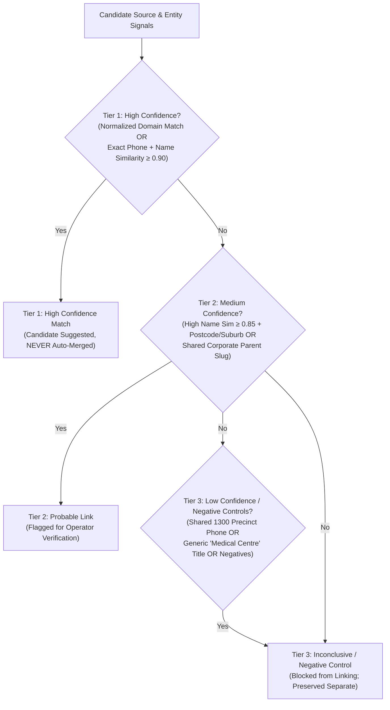
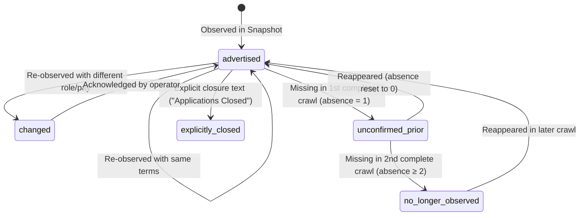

# PracticeSignal — Engineering Deep Dive: Complex Challenges & Technical Breakthroughs

> **Document Classification:** Engineering Specification & Architecture Deep Dive  
> **Author:** Aditya Kadam  
> **System:** PracticeSignal (Healthcare Practice & Workforce Intelligence)  
> **Target Audience:** Technical Evaluators, System Architects & Principal Engineers  

---

## Executive Overview

PracticeSignal is an **evidence-first, deterministic intelligence platform** that resolves entity identities, tracks operational lifecycle events, uncovers cross-source factual conflicts, and monitors healthcare workforce vacancies across distributed, uncoordinated public web sources.

While conventional data platforms rely heavily on probabilistic Large Language Models (LLMs) or simplistic web scraping, **in mission-critical healthcare environments, probabilistic systems fail catastrophically**. LLMs hallucinate non-existent contact coordinates, conflate shared physical infrastructure with corporate mergers, miss temporal negative controls, and lack auditable provenance.

To solve these fundamental problems, PracticeSignal implements a **hybrid deterministic-probabilistic architecture**:
- **Untrusted Extraction Boundary:** The local LLM (`llama3.2:3b` via Ollama) is strictly treated as an unverified probabilistic parser whose suggestions are quarantined.
- **Deterministic Verification & Intelligence Core:** 100% of entity resolution, factual grounding, character-offset verification, temporal change detection, absence accounting, and audit logging are governed by custom, mathematically verifiable Python algorithms and SQLite engine-level triggers.

Below is an in-depth breakdown of the **five most complex engineering challenges** solved during the development of PracticeSignal.

---

## 1. Challenge 1: The Shared Infrastructure vs. Corporate Acquisition Dilemma

### The Problem
In Australian healthcare, independent general practices, allied health specialists, and pathology providers routinely share:
- A single physical address (e.g. *Suite 102, 12-14 Nelson Road, Box Hill*).
- A shared medical precinct reception desk or 1300 directory phone number.
- Common marketing portals or corporate parent branding.

Naïve entity matching algorithms (such as standard Jaro-Winkler, cosine embeddings, or naive fuzzy matching) calculate high similarity scores based on shared phones or addresses and **catastrophically auto-merge independent legal entities into a single corrupted record**. Conversely, strict exact matching fails to recognise legitimate branch networks or legitimate corporate acquisitions.

### The Solution: Conservative 3-Tier Entity Resolver (`entity_resolver.py`)
Rather than relying on continuous similarity scoring or automated mergers, I designed a **multi-signal, 3-tier deterministic classification automaton**:



#### Core Algorithmic Safeguards:
1. **Generic Token Stripping:** Healthcare terms such as `"Medical Centre"`, `"Family Practice"`, `"Clinic"`, and `"Healthcare"` are dynamically stripped during token analysis so two clinics named *"Box Hill Medical Centre"* and *"Melbourne Medical Centre"* cannot match on boilerplate terms alone.
2. **Negative-Control Precinct Filters:** The resolver flags shared `1300` / `1800` inbound lines, suite-level multi-tenancy tags, and distinct Australian Business Numbers (ABNs).
3. **Zero Auto-Merge Invariant (D39):** Under no circumstance does the software automatically execute an SQL `UPDATE` or `MERGE` on `organisations`. Pairwise relationships are persisted as `OrganisationMatchCandidate` records, requiring an explicit human decision.

---

## 2. Challenge 2: Exact Character-Offset Grounding Across Normalised DOM Trees

### The Problem
When extracting facts from web pages (e.g., an address or telephone number), proving **truth and provenance** is essential. If a system claims a clinic is located at *"Suite 102, 12-14 Nelson Road"*, an operator must see the exact highlighted text in the original document.

However, web pages are volatile:
- HTML contains non-breaking spaces (`&nbsp;`), invisible soft hyphens, zero-width spaces, arbitrary whitespace sequences, and variable line-breaks.
- Stripping HTML alters string indices, causing character offsets (`start_offset`, `end_offset`) to point to incorrect words or out-of-bounds byte locations.
- LLMs often subtly alter numbers (e.g. converting `(03) 9419 8888` to `+61 3 9419 8888` or adding hyphens), which breaks exact subslice matching.

### The Solution: Two-Phase Coordinate Normalisation & Verification (`evidence_verifier.py`)
I engineered a deterministic text pipeline that maps normalized extracted quotes back to raw document byte coordinates with 100% precision:

1. **Deterministic Text Assembly:** The parser traverses the DOM tree, computing cumulative character offsets while recording structural heading spans `(level, heading_text, start_offset, end_offset)`.
2. **Multi-Pass Subslice Verification:**
   - **Pass 1 (Exact Binary Slice):** Checks whether `snapshot.text[start_offset:end_offset] == quote`.
   - **Pass 2 (Canonical Substring Alignment):** If the LLM omitted surrounding punctuation, a search space bounded by the enclosing section identifies the exact byte boundaries.
   - **Pass 3 (Semantic Disambiguation):** If the exact same phrase (e.g. an address) appears under multiple headings (e.g. *"Carlton Branch"* vs *"Box Hill Branch"*), the verifier examines nearest preceding headings to determine ownership and eliminate scope ambiguity.
3. **Hard Failure Mode:** If a quote cannot be verified against the stored snapshot, the candidate fact is flagged as `unverified` and quarantined.

---

## 3. Challenge 3: Temporal Absence Accounting vs. Premature Opportunity Closure

### The Problem
When monitoring workforce vacancies (such as General Practitioner or Registered Nurse recruitment advertisements), web crawlers frequently observe a vacancy disappear from a clinic's career page.

A naïve system assumes: *Disappeared = Position Filled or Closed*.

In the real world, this assumption is fatally flawed:
- A page may experience a temporary network timeout (HTTP 500/504).
- A CMS redesign might temporarily misplace the careers section.
- An agency ad may temporarily expire before being renewed.
- Marking a role as "Filled" when the clinic is still desperately recruiting wastes critical healthcare placement opportunities.

### The Solution: 5-State Monotonic Absence Automaton (`opportunity_detector.py`)
I implemented a formal finite-state machine that tracks consecutive absences across successive crawls:

$$\text{State Transitions: } \text{advertised} \xrightarrow{\text{absence=1}} \text{unconfirmed\_prior} \xrightarrow{\text{absence=2}} \text{no\_longer\_observed}$$



#### Mathematical Invariants:
1. **Network Error Freeze:** If a crawl produces an HTTP error, DNS failure, or partial parse, `consecutive_absences` is strictly **frozen**. A technical failure is never conflated with a real-world change.
2. **The "Never Infer Hired" Law:** The status values `filled` or `hired` are strictly prohibited in the database schema. The system only reports what was observed: `possibly_stale`, `no_longer_observed`, or `explicitly_closed`.
3. **Verbatim Closure Evidence:** Transition to `explicitly_closed` strictly requires verbatim textual proof (e.g. *"Recruitment for this vacancy closed on 14 November"*).

---

## 4. Challenge 4: Practice Lifecycle Disambiguation (Permanent Closure vs. Holiday Notices)

### The Problem
Healthcare practices frequently publish notices containing words like *"Closed"*, *"Relocated"*, or *"Notice"*.

Simple keyword scrapers produce catastrophic false alarms:
- A notice stating *"Our clinic will be closed for the Queen's Birthday public holiday"* causes the practice to be marked as permanently closed.
- A notice stating *"Closed temporarily from 1:00 PM to 2:00 PM for staff training"* triggers an emergency closure alert.
- A notice stating *"Our Box Hill branch is closing"* causes the entire healthcare organisation (including 5 other active clinics) to be marked as defunct.

### The Solution: Deterministic Negative-Control Filter & Hierarchical Scope Isolation (`practice_lifecycle_detector.py`)

I engineered a multi-layered linguistic classification engine:

1. **Negative-Control Filter Matrix:**
   Before any text is evaluated for permanent closure, it passes through a regex matrix of negative controls:
   ```python
   TEMPORARY_PATTERNS = [
       r"closed (?:for|on) (?:the )?(?:public|bank )?holiday",
       r"closed (?:today|this afternoon|for lunch)",
       r"closed (?:temporarily|for renovations?|for maintenance)",
       r"re-?opening (?:on|at|tomorrow)",
   ]
   ```
   If a match is found, the event is immediately classified as `temporary_closure` and permanently blocked from the `permanent_closure` pipeline.

2. **Branch vs. Organisation Scope Isolation:**
   When a permanent closure is verified, the engine analyzes surrounding text to extract geographical tokens (`suburb`, `street`, `branch_name`). If the closure is confined to a branch:
   - `is_branch_level = True`
   - `branch_locality = "Box Hill"`
   - The parent organisation record remains `status = "active"`.

3. **Deterministic Date Parsing:**
   The engine extracts explicit closure dates (e.g. *"31 December 2026"*) with ISO date-precision tracking (`exact`, `month`, `quarter`), ensuring temporal events are scheduled correctly.

---

## 5. Challenge 5: Storage-Engine Level Immutability & Anti-Tamper Audit Ledger

### The Problem
In regulated healthcare compliance, maintaining an unalterable audit trail is non-negotiable. If an operator reviews a conflict and makes a decision, that decision must be permanently recorded.

Standard application-level logging is insufficient:
- Application code bugs can accidentally call `session.delete(review_action)` or `session.commit()` on modified objects.
- Direct database administration scripts or maintenance routines can inadvertently alter historical records.
- Soft-delete flags (`is_deleted = true`) can be flipped or ignored in queries.

### The Solution: Native SQLite Anti-Tamper Engine Triggers (`orm.py`)
To solve this at the lowest possible layer, I implemented native database triggers directly inside the SQLite storage engine:

```sql
CREATE TRIGGER IF NOT EXISTS prevent_review_actions_update
BEFORE UPDATE ON review_actions
BEGIN
    SELECT RAISE(FAIL, 'UPDATE on review_actions is prohibited: audit records are append-only');
END;

CREATE TRIGGER IF NOT EXISTS prevent_review_actions_delete
BEFORE DELETE ON review_actions
BEGIN
    SELECT RAISE(FAIL, 'DELETE on review_actions is prohibited: audit records are append-only');
END;
```

#### Engineering Guarantees:
- **Zero-Bypass Enforcement:** Even if application Python code executes an `UPDATE` or `DELETE` statement, the SQLite C-engine itself aborts the transaction immediately with `sqlite3.IntegrityError`.
- **Idempotency Key Constraints:** All change events and lifecycle records carry cryptographic `idempotency_key` hashes (`sha256(source_id + entity_id + event_type + timestamp)`), ensuring duplicate crawl passes can never insert duplicate audit rows.

---

## Summary of Architectural Invariants

| Domain | Probabilistic Model (LLM) Role | Deterministic Python Engine Role |
| :--- | :--- | :--- |
| **Field Extraction** | Proposes candidate field key & raw value | Validates exact character offsets against raw bytes; rejects hallucinated quotes |
| **Entity Matching** | Not used (unreliable) | 3-Tier similarity automaton; separates generic tokens; prevents auto-merging |
| **Discrepancy Detection** | Not used | Exact value divergence checks across linked sources; preserves both competing facts |
| **Vacancy Lifecycle** | Proposes role title & remuneration text | Monotonic absence counter; network error freeze; 5-state lifecycle automaton |
| **Practice Closure** | Proposes notice summary | Regex negative-control filter; branch-scope isolation; date-precision parsing |
| **Audit Ledger** | Not used | Native SQLite `BEFORE UPDATE` / `BEFORE DELETE` triggers physically prevent mutation |

---
*Authored by Aditya Kadam as part of the PracticeSignal Technical Architecture.*
