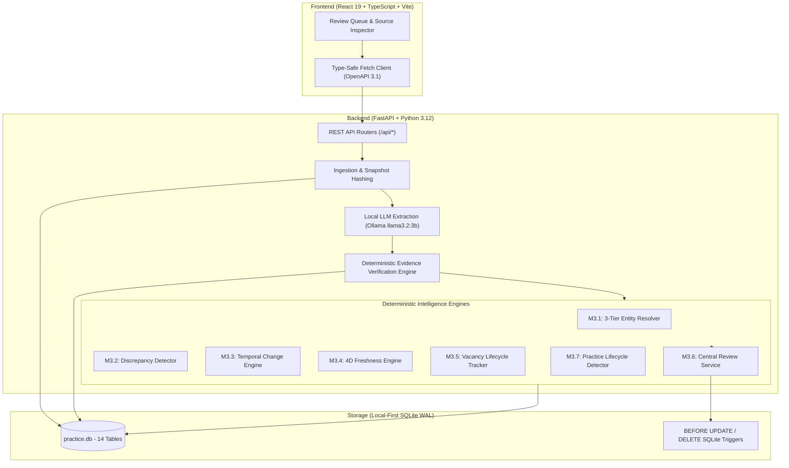

# PracticeSignal — Video Presentation Script & Assessor Guide

> **Document Type:** Assessor Video Recording Script & Technical Demonstration Guide  
> **Target Duration:** Approximately 5–7 minutes  
> **Speaker Role:** Student / Software Engineer presenting their completed project  
> **Target Audience:** Academic Assessor / Technical Interviewer  
> **Project Repository:** PracticeSignal (`d:\Gokul-Submission`)  
> **Baseline Commit:** `6741e9045c3f507316c7b63bd3993dcc28b6d467` on `main`  
> **Backend Baseline:** 327 passing automated tests  

---

## Script Overview & Speaking Guidelines

This script is structured for a natural, professional delivery. It avoids hype, marketing buzzwords, and corporate jargon, presenting the project as an engineer who built and understands every layer of the system.

Each section contains four dedicated components:
- **WHAT I SAY:** The exact spoken words, written in natural, clear, first-person language.
- **ON SCREEN:** What your screen recording or camera should display at that exact moment.
- **DEMO ACTION:** The exact physical action to take (mouse clicks, scrolling, navigation).
- **ESTIMATED TIME:** Expected timestamp range to maintain a crisp 5–7 minute pace.

---

## Part 1: Opening & Introduction

- **ESTIMATED TIME:** 0:00 – 0:40 (40 seconds)
- **ON SCREEN:** Web browser open to PracticeSignal dashboard (`http://localhost:5173/#/sources`). Top header clearly shows "PracticeSignal — Healthcare Practice & Workforce Intelligence" and the green "backend connected" badge. Camera picture-in-picture in the corner showing you speaking.
- **DEMO ACTION:** Keep hands visible or cursor hovering naturally over the brand title in the header.

**WHAT I SAY:**
> "Hi everyone, my name is Gokul, and today I’m presenting **PracticeSignal**, an evidence-first healthcare practice and workforce intelligence platform that I built.
>
> In one sentence: **PracticeSignal deterministically tracks, verifies, and audits changes in healthcare practice operations, contact details, workforce vacancies, and practice lifecycles across distributed public sources.**
>
> I chose to build PracticeSignal because in the healthcare sector, operational information is notoriously fragmented. When an organisation moves, closes a branch, or advertises an urgent GP vacancy, that information appears across clinic websites, corporate group portals, and public directories. But conventional tools either rely on manual monitoring or use black-box AI that hallucinates details. I wanted to engineer a system that treats every piece of intelligence as an evidence-backed claim with verifiable provenance and human oversight."

---

## Part 2: The Real-World Problem

- **ESTIMATED TIME:** 0:40 – 1:30 (50 seconds)
- **ON SCREEN:** Switch tab to `#/reviews` (Review Queue). Show the summary stat cards: Pending Items, Under Review, Deferred Items, and Recorded Decisions.
- **DEMO ACTION:** Slowly scroll down through the review queue cards showing different categories: Organisation Matches, Factual Discrepancies, Workforce Opportunities, and Practice Lifecycle signals.

**WHAT I SAY:**
> "Let’s look at the real-world problem this solves.
>
> Healthcare operations, recruitment teams, and medical locum agencies face a constant challenge: clinic information changes constantly, but nobody announces it in one central registry.
>
> For example, imagine a multi-clinic group called 'Metro Health'. Their Box Hill branch permanently closes on September 30th, while their Carlton branch relocates down the street. Meanwhile, an online directory still lists the old Box Hill phone number from two years ago, and their careers page advertises an urgent full-time GP position that was actually closed last month.
>
> If an operations team acts on this outdated data, they send patients to closed addresses, make useless locum placement calls, and rely on conflicting phone numbers.
>
> Merely scraping text with an LLM isn't enough. LLMs summarise well, but they hallucinate facts, guess coordinates, and cannot be audited. PracticeSignal solves this by splitting the problem: **we let local AI extract candidate information, but we require strict, deterministic Python algorithms to verify exact character offsets against raw immutable snapshots before anything is presented to an operator.**"

---

## Part 3: System Architecture & Technologies

- **ESTIMATED TIME:** 1:30 – 2:30 (60 seconds)
- **ON SCREEN:** Display a clean slide or diagram showing the PracticeSignal architecture, then transition back to the live app at `#/health`.
- **DEMO ACTION:** Click `#/health` in the top navigation. Show the database connection status, SQLite path, and Ollama model configuration.



**WHAT I SAY:**
> "Here is how PracticeSignal is architected under the hood.
>
> On the frontend, I used **React 19, TypeScript, and Vite**. The frontend uses a custom hash-based router with zero routing dependencies, and all API types are generated directly from FastAPI’s OpenAPI 3.1 specification, ensuring end-to-end type safety.
>
> On the backend, I built a modular **FastAPI** service in Python 3.12.
>
> For extraction, we use a local, zero-cost LLM—specifically **Ollama running Llama 3.2 3B**. But crucially, the LLM is never the final authority. When the LLM proposes an extracted fact, our deterministic evidence engine locates the exact character offsets in the raw HTML text snapshot. If the quote doesn't match the raw bytes byte-for-byte, the fact is rejected.
>
> Once verified, the facts pass through seven deterministic intelligence engines:
> 1. Our **3-tier Entity Resolver** for organisation matching.
> 2. Our **Discrepancy Detector** for cross-source value mismatches.
> 3. Our **Temporal Change Engine** for snapshot deltas.
> 4. Our **Four-Dimensional Freshness Engine**.
> 5. Our **Workforce Vacancy Lifecycle Tracker**.
> 6. Our **Practice Lifecycle Engine** for closures, relocations, and acquisitions.
> 7. And our **Central Human Review Service**.
>
> For data storage, we use a local-first **SQLite database with Write-Ahead Logging (WAL)**. To enforce audit immutability, we built custom SQLite database triggers that physically block SQL updates and deletes on the review action ledger."

---

## Part 4: Practical Demonstration Walkthrough

- **ESTIMATED TIME:** 2:30 – 4:45 (2 minutes 15 seconds)
- **ON SCREEN:** Live application in browser.

### Step 1: Sources & Ingestion
- **ON SCREEN:** Navigate to `#/sources`.
- **DEMO ACTION:** Point out the list of registered sources (e.g., F1 Home, F3 Contact, F5 Vacancies). Click on Source #3 (`Contact page archetype`).

**WHAT I SAY:**
> "Let's walk through a live demonstration of how data flows through PracticeSignal.
>
> On the **Sources** page, we see our registered healthcare sources. Here we have Source ID 3, an archetype contact page.
>
> When we open this source, we see its complete snapshot history. Notice that each snapshot has an immutable SHA-256 content hash and recorded heading structure. If a crawl runs and the content has not changed, PracticeSignal short-circuits the observation: it records a heartbeat but avoids duplicate snapshots or unnecessary re-extractions."

### Step 2: Evidence Verification & Candidate Facts
- **ON SCREEN:** Click on Snapshot ID 3 (or navigate to `#/snapshot/3`). Show the raw snapshot text on the left and the extracted facts table on the right.
- **DEMO ACTION:** Hover over a fact row (e.g. Phone: `03 9999 1111`) and click to highlight the evidence quote.

**WHAT I SAY:**
> "Now let's look at **Snapshot Detail**.
>
> On the right, we see the extracted candidate facts: public telephone, address, and operating hours. Notice that every single fact has an associated `evidence_id` with exact start and end character offsets.
>
> If I inspect the quotation, the system verifies that the text between character offset 42 and 63 matches the exact raw string in the DOM. If an LLM hallucinates an address that isn't in the snapshot text, our deterministic coordinate check immediately catches it and flags it for review."

### Step 3: Human Review Queue & Factual Discrepancies
- **ON SCREEN:** Click `Review Queue` (`#/reviews`) in top navigation.
- **DEMO ACTION:** Select category filter: `Factual Discrepancies`. Click on the first discrepancy card to open the modal inspector.

**WHAT I SAY:**
> "Now let's open the heart of our human-in-the-loop workflow: the **Review Queue**.
>
> Here we see cross-source discrepancies. For example, two independent sources linked to the same practice report different phone numbers: Source A reports `03 9999 1111`, while Source B reports `03 8888 2222`.
>
> When I click to inspect, the modal provides a side-by-side divergence comparison with verbatim source quotes, character offsets, and source URLs.
>
> Most importantly: when an operator resolves this in favour of Source A, **PracticeSignal never overwrites or deletes Fact B**. Both facts and their underlying snapshots remain completely intact in history; only the resolution decision is recorded."

### Step 4: Practice Lifecycle Intelligence (Closure, Relocation, Acquisition)
- **ON SCREEN:** In `#/reviews`, change category filter to `Practice Lifecycle (Closure/Relocation/Acquisition)`.
- **DEMO ACTION:** Click on a Permanent Closure card (e.g. Hawthorn Medical) to open its modal detail.

**WHAT I SAY:**
> "Next, let's inspect our Milestone 3.7 capability: **Practice Lifecycle Intelligence**.
>
> Here the system detected that Hawthorn Medical published: *'This medical practice is now permanently closed on 30 September 2026.'*
>
> Notice three critical engineering safeguards:
> 1. **Temporal Date Precision:** The engine parsed the explicit date `2026-09-30` with `day` precision.
> 2. **Branch vs Organisation Isolation:** If a notice says *'Our Box Hill branch will cease operating'*, the engine isolates the closure to the Box Hill branch scope. The parent organisation and sibling branches in Carlton and Richmond remain active.
> 3. **Strict Negative Controls:** If a clinic posts *'Closed for the public holiday'* or *'Temporarily closed for renovations'*, our deterministic filters classify that strictly as a `temporary_closure`. It is physically impossible for holiday or renovation text to trigger a permanent closure event."

### Step 5: Recording a Decision & Audit Ledger
- **ON SCREEN:** Inside the open review modal, enter reviewer name `analyst_gokul`, select action `accepted`, enter notes: `Verified against official practice closure statement`, and click Submit Decision.
- **DEMO ACTION:** Switch to the `Audit History` tab at the top of the Review Queue.

**WHAT I SAY:**
> "Now, I will record a decision as `analyst_gokul`. I enter my rationale: *'Verified against official practice closure statement'*, and submit.
>
> When I switch to the **Audit History** tab, we see the newly recorded decision in our audit ledger with timestamp, reviewer ID, reason code, and notes.
>
> This ledger is enforced at the database level: SQLite `BEFORE UPDATE` and `BEFORE DELETE` triggers prevent any script or user from tampering with this audit trail."

---

## Part 5: Technical Challenges & Key Decisions

- **ESTIMATED TIME:** 4:45 – 5:45 (60 seconds)
- **ON SCREEN:** Switch camera to full-screen speaker view, or show terminal running the passing test suite.
- **DEMO ACTION:** Display terminal output showing `327 passed in 37.86s`.

**WHAT I SAY:**
> "During the engineering of PracticeSignal, I made several deliberate architectural decisions:
>
> 1. **Zero Auto-Merging:** In entity resolution and corporate acquisitions, many tools automatically merge organisations that share a domain or phone number. We strictly forbid this. Shared corporate 1300 numbers or parent branding do not prove legal acquisition. We preserve both organisations with distinct IDs and require human verification.
> 2. **Absence Accounting vs Premature Closure:** If a fact or vacancy disappears from a crawl, we never assume it was immediately filled or closed. A single missing observation marks it `unconfirmed_prior`. Two consecutive complete observations mark it `no_longer_observed`. And status `explicitly_closed` strictly requires verbatim closure proof.
> 3. **Ineligible Crawl Freezing:** If a crawler encounters an HTTP 500 or network timeout, all absence counters are frozen. A technical failure must never be mistaken for real-world practice closure.
> 4. **Local-First Zero-Cost Execution:** The entire system runs locally on standard CPU hardware with ₹0 budget. Zero cloud subscriptions, zero external paid APIs, and zero risk of leaking healthcare organisation data."

---

## Part 6: Responsible Boundaries & Limitations

- **ESTIMATED TIME:** 5:45 – 6:20 (35 seconds)
- **ON SCREEN:** Display `README.md` or a clean slide outlining Scope Boundaries & Synthetic Corpus.
- **DEMO ACTION:** Keep slide clean and clear.

**WHAT I SAY:**
> "I want to be completely clear and responsible about what PracticeSignal is and what it is not.
>
> First, PracticeSignal is an **independent engineering prototype** developed for this project assessment. It is not an enterprise deployment, and it does not connect to live patient databases or production clinical systems like Gokul Infocare, MIRA, or Robina 7 Day Doctors.
>
> Second, **zero patient health records (EMR/EHR) or personal candidate CVs are handled**. The system strictly processes public practice operational metadata and workforce advertisements.
>
> Third, all demonstration data uses our **reproducible synthetic corpus (F1 through F14)**, using reserved `.example.com` domains.
>
> And finally, while our SQLite triggers enforce append-only behavior at the database engine level, this is an application audit log, not cryptographic blockchain tamper-proofing against someone with raw disk-sector access."

---

## Part 7: Conclusion & Closing

- **ESTIMATED TIME:** 6:20 – 6:50 (30 seconds)
- **ON SCREEN:** Camera full screen on you, confident and smiling.

**WHAT I SAY:**
> "To summarise: PracticeSignal demonstrates how modern AI extraction can be paired with rigorous, deterministic engineering. By treating AI output as unverified proposals, validating character offsets against immutable snapshots, and preserving complete historical provenance, we provide actionable healthcare intelligence without sacrificing truth.
>
> The repository includes 327 passing automated tests across 11 test suites covering every contract, migration, and edge case from M0 through M3.7.
>
> Thank you very much for your time, and I look forward to your questions."

---

## Demo Preparation Checklist (Before Recording)

To ensure your recording runs smoothly without unexpected errors, complete this 5-minute checklist:

### 1. Terminal Setup
Open two PowerShell terminal tabs in `d:\Gokul-Submission`:

- **Terminal 1 (Backend Server):**
  ```powershell
  .venv\Scripts\python -m uvicorn backend.app.api.main:app --host 127.0.0.1 --port 8000
  ```
  *Verify:* Check `http://127.0.0.1:8000/docs` in your browser. It should show 47 endpoints and status 200.

- **Terminal 2 (Frontend Dev Server):**
  ```powershell
  npm run dev
  ```
  *Verify:* Check `http://localhost:5173`. The green badge `backend connected` should appear in the top right.

### 2. Pre-Seed Verification Test Data
If the review queue is empty, run a quick seeding command in Terminal 3:
```powershell
.venv\Scripts\python -c "from backend.app.db.base import get_engine, session_scope; from backend.app.intelligence.practice_lifecycle_detector import detect_practice_lifecycle_events; from backend.app.intelligence.review_service import get_review_metrics; s = session_scope().__enter__(); print('Metrics:', get_review_metrics(s))"
```

### 3. Browser Setup
- Open Chrome or Edge to `http://localhost:5173`.
- Set zoom level to 100% or 110% for crisp readability on video.
- Have tabs ready:
  - Tab 1: `http://localhost:5173/#/sources` (Sources list)
  - Tab 2: `http://localhost:5173/#/reviews` (Review queue)
  - Tab 3: `http://localhost:5173/#/health` (Health & DB status)

---

## Anticipated Assessor Questions & Grounded Answers

### Q1: "Why did you use SQLite instead of PostgreSQL?"
**Answer:**
> "PracticeSignal is architected as a local-first, zero-cost intelligence system designed to run on an analyst's desktop without requiring Docker containers or cloud database credentials. SQLite with WAL (Write-Ahead Logging) mode provides ACID compliance, fast single-file portability, and zero-configuration bootstrap. Furthermore, we implemented database-level `BEFORE UPDATE` and `BEFORE DELETE` triggers in SQLite to enforce append-only immutability on our review audit ledger."

### Q2: "How do you prevent the local LLM from hallucinating practice details?"
**Answer:**
> "We enforce a strict separation between candidate extraction and evidence verification. The LLM (Ollama running Llama 3.2 3B) only proposes candidate facts with an accompanying quotation. Before any fact is accepted into the database, our Python verification engine checks that the quotation exists verbatim in the raw snapshot text at the specified start and end character offsets. If the text does not match character-for-character, the fact is rejected as unverified."

### Q3: "What prevents a holiday closure notice from being mistaken for a permanent practice closure?"
**Answer:**
> "In `practice_lifecycle_detector.py`, we implement deterministic negative-control pattern matching before evaluating permanent closure. Phrases like 'closed today', 'closed for lunch', 'closed for the public holiday', or 'temporarily closed for renovations' are explicitly trapped and routed to `temporary_closure`. They can never produce a `permanent_closure` event. Permanent closure strictly requires fact-specific permanence wording such as 'permanently closed' or 'has permanently ceased operations'."

### Q4: "Why don't you automatically merge organisations when they share a phone number or domain?"
**Answer:**
> "In healthcare, shared infrastructure is very common. Independent specialists often share a medical precinct building, a common reception desk, or an aggregator directory link. Automatically merging organisations based on domain or phone numbers leads to catastrophic data loss where distinct legal practices are collapsed into one. PracticeSignal's 3-tier entity resolver always preserves distinct organisation records and outputs reviewable match candidates for human operator verification."

### Q5: "How does your system handle workforce vacancies without falsely marking them as 'filled'?"
**Answer:**
> "Status `filled` or `hired` is strictly forbidden in our architecture. When an advertised role disappears from a website, it might have been filled, but it might also have been cancelled, expired, or temporarily omitted during a website redesign. PracticeSignal uses consecutive absence tracking: 1 absence produces `unconfirmed_prior`, 2 consecutive complete absences produce `no_longer_observed`, and only an explicit notice (like 'Applications Closed') produces `explicitly_closed`. We never guess recruitment outcomes."
