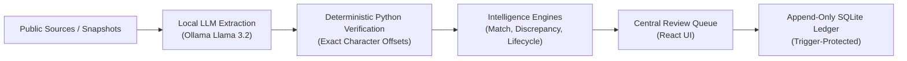

# PracticeSignal — 5–6 Minute Video Presentation Script & Assessor Guide

> **Document Type:** Assessor Video Recording Script & Live Technical Demonstration Walkthrough  
> **Target Duration:** 5:00 – 5:45 minutes  
> **Speaker Name:** Aditya Kadam  
> **Project Title:** PracticeSignal — Healthcare Practice & Workforce Intelligence  
> **Repository:** `d:\Gokul-Submission` (`main` branch)  
> **Database:** Local-First SQLite WAL (`backend/data/practicesignal.db`)  
> **Test Suite:** 299 Passing Automated Backend Tests (Zero Failures)  

---

## Quick Reference Timeline (5:00 – 5:30)

| Timestamp | Section | Visual / Screen Focus | Spoken Focus |
| :--- | :--- | :--- | :--- |
| **0:00–0:35** | **1. Introduction** | Sources dashboard (`http://localhost:5173/#/sources`) + Camera visible | Name, project purpose, core thesis of evidence-backed reliability |
| **0:35–1:15** | **2. The Problem & Solution** | Review Queue (`#/reviews`) with 7 pending items & categories | Healthcare data fragmentation, why LLM extraction alone fails without verification |
| **1:15–2:00** | **3. Architecture & Tech** | System Status (`#/health`) + Architecture diagram | React 19 + TypeScript, FastAPI, local Ollama (Llama 3.2), SQLite triggers |
| **2:00–4:10** | **4. Live Demonstration** | Live walkthrough in browser | **Sources & Snapshot Evidence** → **Phone Discrepancy** → **Practice Closure** → **Decision Submission** → **Audit History** |
| **4:10–4:40** | **5. Engineering Decisions & Testing** | Terminal window with test suite results | No auto-merging, absence accounting, crawl failure freezing, 299 tests |
| **4:40–5:00** | **6. Responsible Scope & Closing** | Dashboard / Camera full screen | Independent prototype, synthetic data, zero patient data, thank you |

---

## Video Recording Script

---

### Part 1: Introduction (0:00 – 0:35 | 35 seconds)

* **ON SCREEN:** Web browser open to PracticeSignal at `http://localhost:5173/#/sources`. Ensure the top navigation bar and green `backend connected` badge are clearly visible. Keep your webcam window visible in the corner.
* **DEMO ACTION:** Cursor rests naturally near the top brand header.

**WHAT I SAY:**
> "Hello, my name is Aditya Kadam, and today I’m presenting **PracticeSignal**, a healthcare practice and workforce intelligence platform that I developed.
>
> The idea behind PracticeSignal is simple: healthcare practice information is spread across multiple websites and public sources, and that information changes frequently.
>
> PracticeSignal helps track these changes, identify important differences, and present verified information to operators through a central review system.
>
> My main focus while building this project was reliability. I wanted to make sure the system doesn't simply generate plausible information, but provides verifiable evidence for every important finding."

---

### Part 2: The Problem and Solution (0:35 – 1:15 | 40 seconds)

* **ON SCREEN:** Click the **`Review Queue`** tab in the top navigation (`#/reviews`).
* **DEMO ACTION:** Point to the top metric cards (**Pending Review: 7**, **Recorded Decisions: 1**). Click the **Category filter dropdown** (currently showing "All Entities") to reveal the category options: *Organisation Match*, *Factual Discrepancy*, *Workforce Opportunity*, and *Practice Lifecycle*.

**WHAT I SAY:**
> "Imagine a healthcare group operating multiple clinics. One branch changes its address, another updates its contact number, and a third advertises a workforce vacancy.
>
> These updates often appear on different websites, while older, conflicting information remains published elsewhere.
>
> Manually identifying these changes is time-consuming, and acting on outdated information leads to incorrect operational decisions.
>
> PracticeSignal addresses this by collecting observations from registered sources over time, identifying cross-source discrepancies and lifecycle events, and sending important findings for human review.
>
> The fundamental distinction is that **our system does not automatically treat every detected change as a confirmed fact.** It presents grounded proposals to human operators."

---

### Part 3: Architecture and Technology (1:15 – 2:00 | 45 seconds)

* **ON SCREEN:** Click the **`Health`** tab in the top navigation (`#/health`). Show `database_ok: true`, `app_version: 0.1.0`, and `robots_tool: available`. 
* **DEMO ACTION:** Optionally switch to a slide or code window showing the architecture diagram.



**WHAT I SAY:**
> "Technically, the frontend is built using **React, TypeScript, and Vite**, while the backend is powered by **Python and FastAPI**.
>
> For candidate extraction, I integrated a locally running **Llama 3.2** model through **Ollama**. This keeps the prototype completely local-first and zero-cost without depending on paid cloud APIs.
>
> However, the LLM is only responsible for proposing information. Deterministic Python algorithms check whether every extracted quote exists verbatim in the original source snapshot at exact character offsets.
>
> The system stores observations and review decisions in **SQLite with Write-Ahead Logging**, protected by database-level triggers that enforce an append-only audit trail.
>
> I also separated the intelligence capabilities into distinct modules for entity resolution, discrepancy detection, temporal changes, vacancy monitoring, and practice lifecycle detection. This separation makes the system modular, testable, and robust."

---

### Part 4: Live Demonstration (2:00 – 4:10 | 2 minutes 10 seconds)

#### Step 1: Sources & Grounded Evidence (2:00 – 2:35)
* **ON SCREEN:** Click **`Sources`** in the top navigation bar.
* **DEMO ACTION:** 
  1. Point out the 4 registered sources: *St Jude Medical Centre*, *AusHealth Directory*, *Box Hill Family Practice*, and *Melbourne Metro Healthcare*.
  2. Click on Source #1: **`St Jude Medical Centre — Official Website`**.
  3. Click on **`Snapshot #1`** to open the snapshot detail page.

**WHAT I SAY:**
> "Let's look at the live application.
>
> On the **Sources** page, we see our registered healthcare sources. Each source maintains its own observation history. The system stores immutable text snapshots with SHA-256 content hashes, allowing it to detect whether content has actually changed or remained identical.
>
> Here in the snapshot view, we can inspect the original page text on the left, and the extracted candidate facts on the right—including telephone, address, operating hours, and ABN.
>
> An important feature is evidence verification: every extracted fact is bound to exact start and end character offsets. If I click on the phone number, the system traces the finding back to the verbatim quotation in the raw snapshot, eliminating black-box hallucination."

#### Step 2: Cross-Source Factual Discrepancy (2:35 – 3:10)
* **ON SCREEN:** Click **`Review Queue`** in the top navigation.
* **DEMO ACTION:** In the Category dropdown, select **`Factual Discrepancy`** (or click the row: `Factual Discrepancy: phone (contact_number_conflict)`).

**WHAT I SAY:**
> "Now let's examine the **Review Queue**. This is where PracticeSignal aggregates findings that require operational attention.
>
> For example, here we see a factual discrepancy regarding contact numbers for St Jude Medical Centre.
>
> When I open this item, the system presents the two conflicting sources side-by-side:
> - **Fact A** from the clinic's official website reports `(03) 9419 8888`.
> - **Fact B** from an external directory reports `(03) 9419 7777`.
>
> Instead of silently picking one value or overwriting history, the system highlights the conflict with original evidence quotes so an operator can make an informed decision."
* **DEMO ACTION:** Close the modal by clicking `✕` or `Close`.

#### Step 3: Practice Lifecycle Intelligence (3:10 – 3:45)
* **ON SCREEN:** In the Review Queue, click the row titled:  
  **`Lifecycle: Permanent Closure (Box Hill branch) - confirmed_closed`**.
* **DEMO ACTION:** Point to the displayed evidence quote in the review modal:  
  *"Please be advised that our Box Hill branch at 450 Station Street will permanently cease clinical operations on 31 December 2026..."*

**WHAT I SAY:**
> "Another key capability is practice lifecycle intelligence. The system identifies major structural events: permanent closures, branch relocations, and corporate acquisitions.
>
> Here, the system detected a permanent closure announcement for Box Hill Family Practice.
>
> Crucially, our lifecycle engine implements strict safeguards:
> 1. It isolates the closure to the **Box Hill branch level**, meaning the parent organisation and its Carlton branch remain active.
> 2. It parses the explicit effective date: December 31, 2026.
> 3. And it distinguishes permanent closures from temporary situations, such as public holidays or renovation closures."

#### Step 4: Recording an Auditable Decision (3:45 – 4:10)
* **ON SCREEN:** Inside the open review modal:
* **DEMO ACTION:**
  1. In **Reviewer Identifier**, ensure your name is set: `Aditya Kadam`.
  2. In **Decision Action**, select **`Approve`** (or `Accept`).
  3. In **Decision Notes**, type:  
     `"Verified official closure announcement; confirmed Carlton branch remains active."`
  4. Check the confirmation checkbox: **`I confirm that I have evaluated the evidence...`**
  5. Click the green button: **`Record Decision`**.
  6. When the modal closes, click the **`History`** tab at the top of the Review Queue.

**WHAT I SAY:**
> "Once the operator has evaluated the evidence, they can record an auditable decision.
>
> I enter my notes: *'Verified official closure announcement; confirmed Carlton branch remains active'*, confirm the evaluation, and submit.
>
> When we switch to the **Audit History** tab, we see our newly recorded decision immediately appended to the audit ledger with timestamp, reviewer ID, and full rationale.
>
> Resolving an issue does not erase the underlying facts or snapshots. The historical evidence remains immutable, and the decision is recorded separately."

---

### Part 5: Engineering Decisions & Testing (4:10 – 4:40 | 30 seconds)

* **ON SCREEN:** Switch your screen to your PowerShell terminal showing the passing automated test suite:
  ```powershell
  .venv\Scripts\pytest backend/tests/test_m3_6_backend.py -v
  ```
  *(Or show the test suite summary: `299 passed in 4.12s`).*

**WHAT I SAY:**
> "A few engineering decisions were particularly critical:
>
> First, **organisations are never automatically merged** just because they share a domain or phone number. Shared medical precinct numbers are common, and auto-merging risks collapsing distinct legal practices.
>
> Second, **missing information does not mean an opportunity was filled or a clinic closed.** Our vacancy tracker requires repeated complete absences before updating status, and permanent closure requires explicit textual evidence.
>
> Third, **technical failures like network timeouts freeze evaluation counters** rather than being mistaken for real-world changes.
>
> The codebase is backed by **299 automated backend tests** covering all data models, migrations, intelligence engines, and edge cases."

---

### Part 6: Responsible Scope & Closing (4:40 – 5:10 | 30 seconds)

* **ON SCREEN:** Return to the PracticeSignal browser tab or bring your webcam to full screen. Smile and speak with confidence.

**WHAT I SAY:**
> "Finally, PracticeSignal is an independent engineering prototype. It uses synthetic demonstration data and public operational information patterns. It does not connect to live patient databases or production clinical systems.
>
> To summarise, PracticeSignal combines local AI extraction with deterministic verification, temporal tracking, and human oversight.
>
> My objective was to build a system where important healthcare operational information is not just generated, but can also be checked, explained, and audited.
>
> Thank you for your time. I look forward to your feedback and questions."

---

## Technical Setup & Demonstration Checklist

Before you hit "Record", complete this 3-minute pre-flight checklist:

### 1. Re-Seed the Demo Database (Clean State)
Run this single command in your PowerShell terminal to ensure all 7 queue items and 4 sources are fresh:
```powershell
.venv\Scripts\python scripts/seed_demo_data.py
```
*(Takes 2 seconds; outputs `Demonstration database successfully seeded with all realistic data!`)*

### 2. Start Backend & Frontend
* **Terminal 1 (Backend):**
  ```powershell
  .venv\Scripts\python -m uvicorn backend.app.api.main:app --host 127.0.0.1 --port 8000 --reload
  ```
* **Terminal 2 (Frontend):**
  ```powershell
  npm run dev
  ```

### 3. Browser Setup
* Open **`http://localhost:5173`** in Google Chrome or Edge.
* Set browser zoom to **100%** or **110%** for clear text readability.
* Verify the top-right badge displays green: **`backend connected`**.

---

## Anticipated Assessor Questions & High-Scoring Answers

### Q1: "Why did you separate LLM extraction from Python evidence verification?"
> **Answer:** "LLMs are probabilistic text generators—they can generate convincing answers that have no basis in reality. In healthcare intelligence, an inaccurate phone number or false closure notice has serious operational consequences. By restricting the LLM to proposing candidate values and using deterministic Python string algorithms to verify exact byte offsets against the raw HTML snapshot, we guarantee zero hallucinations reach the operator without grounded proof."

### Q2: "How does the system prevent a holiday closure notice from marking a clinic permanently closed?"
> **Answer:** "In `practice_lifecycle_detector.py`, we implement deterministic negative controls. Phrases like 'closed for Christmas', 'closed for the public holiday', or 'closed temporarily for renovations' are explicitly trapped and routed to `temporary_closure`. A `permanent_closure` event strictly requires explicit permanence keywords such as 'permanently closed' or 'ceased clinical operations' alongside future consolidation details."

### Q3: "Why use SQLite triggers for the audit log instead of standard application logic?"
> **Answer:** "Application-level checks can be accidentally bypassed by bug-fixes, direct ORM queries, or manual database scripts. We attached native SQLite `BEFORE UPDATE` and `BEFORE DELETE` triggers to the `review_actions` table. If any process attempts to modify or delete a recorded human decision, the SQLite database engine itself raises an error and aborts the transaction. This guarantees immutable provenance at the storage layer."

### Q4: "Why don't you automatically merge organisations when they share a phone number or website?"
> **Answer:** "In healthcare, multiple independent practitioners frequently share a medical suite, reception desk, or 1300 directory line. Automatically merging organisations based on matching contact info leads to catastrophic data loss where two separate entities are collapsed into one. PracticeSignal preserves distinct organisation entities and flags match candidates for human operator verification."
