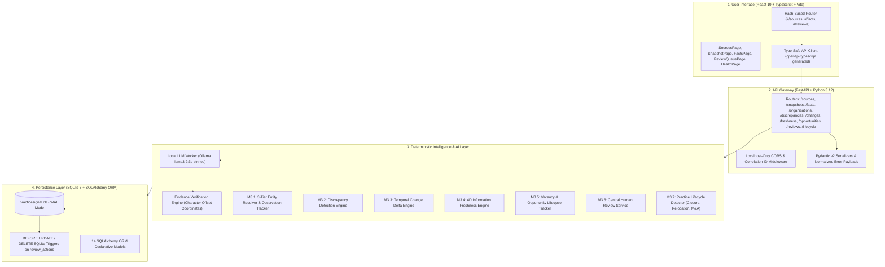
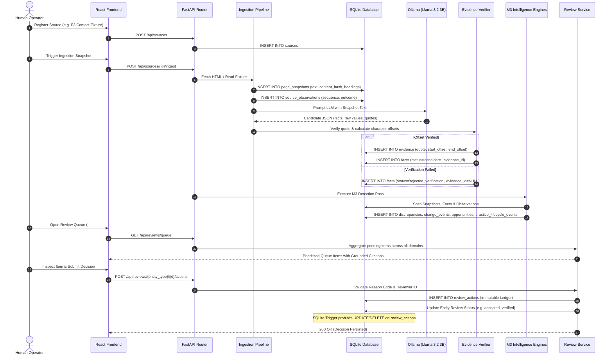
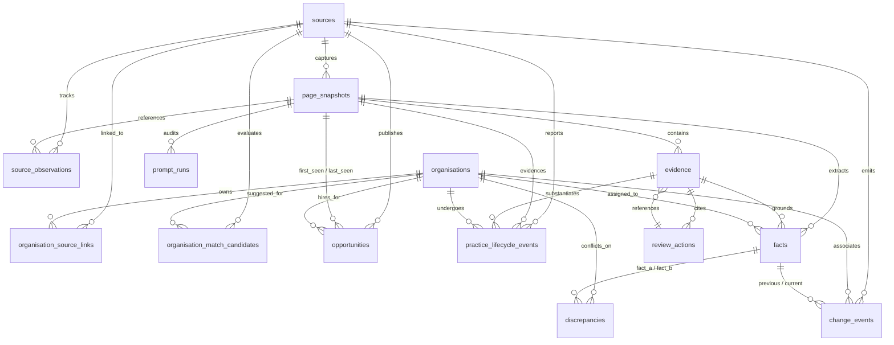
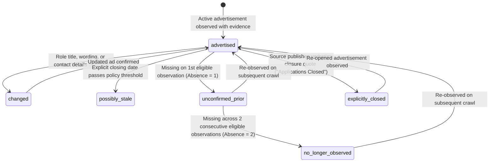

# PracticeSignal — Complete Concepts, Architecture & Implementation Guide

> **Document Type:** Comprehensive Technical Study Guide & Assessor Reference  
> **Target Audience:** Project Author / Senior Assessor / Technical Interviewer  
> **Repository:** PracticeSignal (`d:\Gokul-Submission`)  
> **Baseline Git Commit:** `6741e9045c3f507316c7b63bd3993dcc28b6d467` on `main`  
> **Automated Test Coverage:** 327 passing automated tests across 11 test suites  
> **Scope:** Full-Stack Architecture, Data Contracts, Intelligence Engines, and Milestone Evolution (M0 through M3.7)

---

## 1. Project Overview

### 1.1 What is PracticeSignal?
**PracticeSignal** is a local-first, evidence-backed healthcare practice and workforce intelligence platform. It systematically observes public healthcare information sources (such as clinic contact pages, multi-branch service directories, and career portals), extracts candidate operational facts, deterministically verifies them against immutable raw text snapshots, and detects high-value operational signals:
- Cross-source factual conflicts and discrepancies.
- Temporal changes across successive snapshot observations.
- Multi-dimensional information freshness and staleness.
- Healthcare workforce vacancy lifecycles (GP, Nurse, Allied Health, Administrative).
- Practice lifecycle events (permanent closures, temporary closures, relocations, corporate acquisitions).
- Human review triage and append-only audit trail logging.

### 1.2 Why Does It Exist & What Problem Does It Solve?
Healthcare operational metadata is highly dynamic and decentralized. Unlike financial markets or real estate, there is no single authoritative, real-time database of healthcare clinics. Information is distributed across:
1. Official practice websites.
2. Corporate healthcare parent portals (e.g. multi-clinic groups).
3. Third-party aggregator directories (e.g. National Health Services directories, Yellow Pages).
4. Public job boards and career pages.

When practices change operating hours, relocate down the street, close a physical branch, or recruit new general practitioners, these changes are updated inconsistently. This leads to:
- **Operational Failures:** Locum agencies placing doctors at decommissioned locations or relying on disconnected phone numbers.
- **Patient Inconvenience:** Patients arriving at clinics that have permanently closed or moved.
- **Recruitment Stagnation:** Recruiters spending time chasing expired or already-filled medical vacancies.

### 1.3 Who Uses It?
- **Healthcare Operations Analysts:** Auditing clinic directory accuracy and keeping internal practice management registries synchronized.
- **Medical Recruitment & Locum Agencies:** Monitoring public vacancy notices and identifying practice expansion or workforce shortages.
- **Healthcare Directory Curators:** Resolving cross-source discrepancies between official practice websites and third-party aggregator listings.

### 1.4 What PracticeSignal Does and Does NOT Do
| Capability | PracticeSignal DOES | PracticeSignal DOES NOT |
| :--- | :--- | :--- |
| **Data Scope** | Public clinic operational metadata, contact details, workforce vacancies, practice lifecycle notices. | Patient electronic health records (EHR/EMR), clinical diagnoses, patient health data, personal applicant CVs. |
| **AI Role** | Proposes candidate facts via local LLM (`llama3.2:3b`); Python deterministically verifies exact quotation offsets. | Allow LLM output to become unverified truth without byte-for-byte coordinate proof. |
| **Execution** | Local-first, ₹0 budget, standard CPU workstation execution with SQLite WAL mode. | Require cloud database instances, external paid APIs (OpenAI, Anthropic), or live web scraping during tests. |
| **Entity Handling** | Suggests match candidates; preserves distinct organisation identities with human-in-the-loop review. | Automatically merge organisations or delete historical records when similarity is detected. |
| **Auditing** | Enforces append-only immutable review records using database-level SQLite triggers. | Claim enterprise cryptographic blockchain tamper-proofing against raw disk edits. |

### 1.5 The End-to-End Running Example: "Metro Health Group"
To understand how every capability connects, follow this real-world scenario through the system:
1. **Discovery & Registration:** An analyst registers two sources: Source 1 (the official practice website `https://metrohealth.example.com/contact`) and Source 2 (a directory listing `https://directory.example.com/metro-health`).
2. **Snapshot Ingestion:** PracticeSignal captures an immutable snapshot of both pages, hashing the text with SHA-256 and storing heading structures.
3. **AI Fact Extraction:** The local LLM reads the contact page and extracts a telephone number `03 9999 1111` and street address `10 High Street, Box Hill`. The Python evidence engine verifies that `"03 9999 1111"` exists at character offsets `42:54` in Snapshot 1.
4. **Organisation Linkage:** The 3-tier entity resolver matches both sources to "Metro Health Group" based on domain and postcode, producing an `OrganisationMatchCandidate`.
5. **Cross-Source Discrepancy:** Source 2 claims the telephone is `03 8888 2222`. The Discrepancy Engine flags a `value_mismatch` conflict between Source 1 and Source 2 and queues it for review.
6. **Temporal Change & Freshness:** On a subsequent observation 90 days later, Snapshot 3 is captured. The telephone number remains the same, but the Freshness Engine classifies the fact as `aging` based on monitoring policy thresholds.
7. **Workforce Opportunity:** The careers page advertises a "General Practitioner - VR GP" role. PracticeSignal creates an `Opportunity` record with status `advertised`.
8. **Practice Lifecycle Notice:** A banner is published: *"Our Box Hill branch will cease operating from 15 December 2026."* The Lifecycle Engine detects a `permanent_closure` signal, correctly scopes it to the `Box Hill` branch, and preserves the parent organisation as `active`.
9. **Human Review & Audit:** An operator opens the unified Review Queue, inspects the grounded quotation and offsets, confirms the branch closure, and resolves the phone discrepancy. The decision is permanently appended to `review_actions` via SQLite triggers.

---

## 2. Complete System Architecture & Data Flow

PracticeSignal follows a local-first, modular architecture divided into four distinct layers:



### 2.1 The End-to-End Data Flow



---

## 3. Foundational Data Concepts & Entity Relationship Model

The database schema consists of **14 relational tables** in SQLite, mapped via SQLAlchemy 2.0 ORM models in `backend/app/db/orm.py`.

### 3.1 Foundational Entity Definitions
Understanding the distinctions between these entities is critical:
- **`Source` (`sources`):** A registered web URL or synthetic fixture representing a single public communication channel. Has a defined `page_type` (`contact`, `home`, `services`, `vacancies`) and `policy_status` (`allowed`, `manual_fixture_pending_policy_check`).
- **`PageSnapshot` (`page_snapshots`):** An immutable, point-in-time capture of parsed plain text and structural headings. Identified by a SHA-256 `content_hash`. Multiple crawls of an unchanged page point back to this same snapshot.
- **`SourceObservation` (`source_observations`):** An observation heartbeat recording every crawl attempt. Monotonically numbered (`observation_sequence`). Distinguishes between `success_new_snapshot`, `success_unchanged` (short-circuit), and `failed`.
- **`Organisation` (`organisations`):** The canonical business or legal healthcare entity. Identified by a unique `slug` (e.g. `metro-health-group`), official name, postcode, and state.
- **`OrganisationSourceLink` (`organisation_source_links`):** An additive mapping linking an Organisation to a registered Source. Specifies relationship role (`official_practice_site`, `corporate_parent`, `branch_page`, `third_party_directory`) and verification status (`suggested`, `confirmed`, `rejected`).
- **`Evidence` (`evidence`):** Verifiable textual proof. Stores the exact verbatim quote and the precise character boundaries (`start_offset`, `end_offset`) where that quotation exists in the parent `PageSnapshot.text`.
- **`Fact` (`facts`):** An atomic operational claim extracted from a snapshot (e.g., `phone = "03 9999 1111"`, `address = "10 High St"`). Belongs to a semantic `field_key` and optional `scope_key`. Strictly references its supporting `Evidence` record.
- **`PromptRun` (`prompt_runs`):** An audit record of an LLM invocation. Records the prompt template, input parameters, raw JSON completion, execution duration, and token usage.
- **`OrganisationMatchCandidate` (`organisation_match_candidates`):** A reviewable match suggestion between a Source and an Organisation generated by the 3-tier entity resolver.
- **`Discrepancy` (`discrepancies`):** A detected factual conflict between two independent sources observing the same practice field (e.g. conflicting telephone numbers).
- **`ChangeEvent` (`change_events`):** An observation delta between successive snapshots of a source (`fact_added`, `fact_modified`, `unconfirmed_prior`, `fact_unobserved`, `fact_reappeared`).
- **`Opportunity` (`opportunities`):** A healthcare workforce recruitment vacancy entity (GP, Nurse, Allied Health, Admin) with state transitions from `advertised` to `explicitly_closed`.
- **`ReviewAction` (`review_actions`):** An immutable, application-level audit ledger entry recording a human operator's decision.
- **`PracticeLifecycleEvent` (`practice_lifecycle_events`):** A high-value practice event signal (`permanent_closure`, `temporary_closure`, `relocation`, `acquisition`).

### 3.2 Database Entity Relationship Diagram



---

## 4. AI Extraction & Evidence Verification (Milestone 2)

### 4.1 The Role of the Local LLM
In Milestone 2, PracticeSignal uses **Ollama** running the pinned, lightweight model `llama3.2:3b`. The LLM's sole responsibility is **candidate parsing**: converting unstructured natural language into structured JSON objects containing candidate facts and quotation snippets.

### 4.2 The Extraction Prompt & Schema Enforcement
Extraction prompts are stored in `prompts/extraction_v1.txt`. The prompt instructs the LLM:
1. Extract candidate healthcare practice facts matching allowed fields (`phone`, `address`, `suburb`, `postcode`, `email`, `hours`, `role_title`, `role_category`).
2. Provide an exact, verbatim quotation from the text supporting each fact.
3. Return output strictly in a valid JSON schema:
   ```json
   {
     "facts": [
       {
         "field_key": "phone",
         "raw_value": "03 9999 1111",
         "evidence_quote": "Phone: 03 9999 1111"
       }
     ]
   }
   ```

### 4.3 Deterministic Coordinate Verification
The critical architectural boundary is implemented in `backend/app/intelligence/evidence_verifier.py`:
1. When candidate facts are returned, Python searches `PageSnapshot.text` for the exact verbatim quotation string.
2. If the string is found, it calculates `start_offset` and `end_offset` integers.
3. It performs a slice validation:
   $$\text{PageSnapshot.text}[\text{start\_offset} : \text{end\_offset}] == \text{evidence\_quote}$$
4. If the check passes, an `Evidence` row is persisted, and the `Fact` is assigned `status="candidate"`.
5. If the LLM fabricated or hallucinated the quote, the verification fails: no `Evidence` record is created, and the fact is marked `status="rejected_verification"`.

---

## 5. Organisation Matching & Entity Resolution (Milestone 3.1)

### 5.1 Why Organisation Matching is Difficult
Healthcare directory matching is fraught with edge cases:
- Independent medical suites often share a single building address (e.g. "Suite 2, 100 Main Street").
- Different branches of a corporate group share common 1300/1800 corporate telephone numbers and identical website parent domains.
- Lookalike clinics with generic names (e.g. "City Medical Clinic") operate in different suburbs.

### 5.2 The 3-Tier Entity Resolution Engine (`entity_resolver.py`)
Rather than relying on black-box machine learning or probability scores, PracticeSignal evaluates matching signals using a deterministic, rule-gated 3-tier system:

| Tier | Name | Criteria / Rules | Resulting Status |
| :--- | :--- | :--- | :--- |
| **Tier 1** | `strong_match_suggestion` | Exact local telephone match (E.164) + exact postcode; **or** exact non-aggregator official domain + postcode + locality; **or** approved branch slug + postcode. Rejects corporate 1300/1800 numbers without branch street proof. | `suggested` |
| **Tier 2** | `possible_match` | RapidFuzz token-sort similarity $\ge 88.0$ + exact postcode; **or** approved corporate aggregator + branch slug + street address match. | `needs_review` |
| **Tier 3** | `insufficient_evidence` | Differing postcodes; distinct suites in a medical precinct; shared 1300/1800 corporate numbers without branch street proof; generic clinic names without official domain/phone proof. | Rejected / Suppressed |

### 5.3 The Invariant: Zero Automatic Merging
PracticeSignal strictly enforces that entity matching **never automatically merges organisations**. Match suggestions are recorded in `organisation_match_candidates` for human review. Approving a match candidate links the source to the organisation (`verification_status="confirmed"`), leaving both records fully intact without destructive record consolidation.

---

## 6. Cross-Source Discrepancy Detection (Milestone 3.2)

### 6.1 What is a Discrepancy?
A discrepancy occurs when two independent sources, both confirmed to refer to the same organisation, report conflicting factual values for the same semantic property (e.g. one source reports phone `03 9999 1111` while another reports `03 8888 2222`).

### 6.2 Comparison Eligibility Rules (`discrepancy_detector.py`)
Two facts are eligible for discrepancy comparison if and only if:
1. Both facts are assigned to the same `organisation_id`.
2. Both facts belong to sources with confirmed links (`verification_status == "confirmed"`).
3. Both facts share the same semantic field mapping (e.g., both are normalized to `public_phone` or `address`).
4. Both facts possess valid, verified evidence coordinates in their respective page snapshots.
5. Both facts share the same branch scope key (or both are un-scoped practice-level facts).

### 6.3 Conflict Classifications
- **`value_mismatch`:** Distinct normalized values on comparable scopes (e.g. phone number conflict).
- **`temporal_divergence`:** One source publishes an updated date or recent effective date while another reports older information.
- **`ambiguity`:** Un-scoped facts on multi-branch pages that cannot be definitively attributed to a single clinic location.

---

## 7. Temporal Change Detection (Milestone 3.3)

### 7.1 Observation Delta Engine (`change_detector.py`)
PracticeSignal evaluates changes across successive observations of the same source:
- **`fact_added`:** A new fact appears that was not present in the baseline snapshot.
- **`fact_modified`:** A fact with the same field key changes value (e.g., address changed from "10 High St" to "20 Station Rd").
- **`unconfirmed_prior`:** A previously observed fact is missing from 1 complete observation (absence count = 1).
- **`fact_unobserved`:** A previously observed fact is missing across $\ge 2$ consecutive complete observations.
- **`fact_reappeared`:** A previously unobserved fact re-appears in a subsequent complete crawl.

### 7.2 Ineligible Observation Freezing
To prevent technical crawl failures from corrupting practice intelligence:
- **Failed Crawls (HTTP 500, network error):** Freeze absence counters. Zero change events are emitted.
- **Incomplete Extractions:** Freeze absence counters.
- **Unchanged Observations (`success_unchanged`):** Freeze absence counters. Re-observing the same immutable snapshot does not increment absence.
- **Extraction Omission Protection:** If a fact is missing from the AI output but its key tokens still exist in the snapshot DOM text, the omission is suppressed, protecting against LLM extraction variance.

---

## 8. Four-Dimensional Information Freshness (Milestone 3.4)

### 8.1 The Core Principle: Observation Recency $\neq$ Information Validity
A source crawled 10 minutes ago does not mean the underlying clinic address is current—the page content might not have been updated since 2019. PracticeSignal evaluates freshness across **four distinct, independent dimensions**:

| Dimension | Measured Timestamp | What It Answers | Governance Policy |
| :--- | :--- | :--- | :--- |
| **1. Observation Freshness** | `last_successful_observation_at` | When did PracticeSignal last successfully inspect this source? | Governed by crawl heartbeat policy (default: 30 days). |
| **2. Content Freshness** | `current_version_first_observed_at` | When was this snapshot content first captured without change? | Governed by snapshot content diffs (default: 90 days). |
| **3. Fact Freshness** | `explicit_fact_date` | When did the practice explicitly publish or update this fact? | Governed by published temporal evidence (e.g. "Effective Oct 2026"). |
| **4. Evidence Freshness** | `checked_at` | When was the raw character offset quotation last verified against the snapshot? | Governed by snapshot immutable coordinate integrity. |

### 8.2 Temporal Precision & Range Evaluation
PracticeSignal parses published dates preserving temporal precision:
- `DAY` (e.g. `2026-10-15`): Evaluated as exact timestamp.
- `MONTH` (e.g. `October 2026`): Evaluated as interval `[2026-10-01, 2026-10-31]`.
- `YEAR` (e.g. `2026`): Evaluated as interval `[2026-01-01, 2026-12-31]`.
- `UNKNOWN`: If no explicit publication date is stated, the fact date is marked unknown.

If an incomplete date interval crosses a policy threshold boundary, PracticeSignal classifies the fact freshness as `unknown` rather than guessing a boundary date.

---

## 9. Workforce Vacancy Lifecycle Intelligence (Milestone 3.5)

### 9.1 Vacancy Entity Identity
In `backend/app/intelligence/opportunity_detector.py`, healthcare recruitment openings are tracked as distinct atomic entities (`Opportunity`). Identity is resolved hierarchically:
1. **Priority 1:** Published reference ID (`explicit_ad_id`, e.g. `GP-2026-04`).
2. **Priority 2:** Stable URL slug.
3. **Priority 3:** Composite tuple: `(organisation_id, role_category, branch_locality, source_id)`. Role title and salary are deliberately omitted from the identity key so that title diffs update the existing vacancy instead of creating duplicate records.

### 9.2 The Six Conservative Lifecycle States


### 9.3 Architectural Invariant: Zero "Filled" Inferences
The status `filled` or `hired` is **strictly forbidden**. When a vacancy disappears from a website, the clinic may have hired a doctor, but they may have also cancelled the role, frozen hiring, or redesigned their website. PracticeSignal marks missing vacancies `no_longer_observed`. Status `explicitly_closed` strictly requires verified verbatim closure evidence.

---

## 10. Human Review Workflow & Immutability (Milestone 3.6)

### 10.1 Central Review Queue (`review_service.py`)
PracticeSignal consolidates actionable intelligence findings across all domains into a unified review queue:
- High Priority: Match candidate confirmations, cross-source discrepancies, explicit permanent closures.
- Medium Priority: Temporary closures, address change diffs, workforce vacancy updates.
- Low Priority: Routine candidate facts and freshness acknowledgements.

### 10.2 Defense-in-Depth Immutability Architecture
Review actions are enforced as append-only across three distinct layers:
1. **API Layer:** No `PUT`, `PATCH`, or `DELETE` endpoints exist under `/api/reviews/*`.
2. **Service Layer:** `review_service.py` exposes only `record_review_action()`, with no update or delete operations.
3. **Database Layer (SQLite Triggers):**
   ```sql
   CREATE TRIGGER prevent_review_actions_update
   BEFORE UPDATE ON review_actions
   BEGIN
       SELECT RAISE(FAIL, 'UPDATE on review_actions is prohibited: audit records are append-only');
   END;

   CREATE TRIGGER prevent_review_actions_delete
   BEFORE DELETE ON review_actions
   BEGIN
       SELECT RAISE(FAIL, 'DELETE on review_actions is prohibited: audit records are append-only');
   END;
   ```

---

## 11. Practice Lifecycle Intelligence (Milestone 3.7)

Milestone 3.7 implements deterministic detection of practice closures, relocations, and corporate ownership changes:

### 11.1 Permanent vs Temporary Closure Detection
- **Permanent Closure:** Matches fact-specific permanence phrases (`"permanently closed"`, `"has permanently ceased operations"`, `"this medical practice is now permanently closed"`). Requires verbatim quotation and character offset verification.
- **Negative Controls (Temporary Closures):** Matches phrases like `"closed today"`, `"closed for lunch"`, `"closed for the public holiday"`, `"temporarily closed for renovations"`, `"emergency closure due to power outage"`. Trapped and classified strictly as `temporary_closure` (`status="potential_needs_review"`). **Never** classified as permanent closure.

### 11.2 Branch Scope vs Organisation Scope
If a closure statement mentions a branch (e.g. *"Our Box Hill branch will cease operating"*):
- `branch_locality = "Box Hill"`
- `is_branch_level = True`
- **Parent organisation remains active; sibling branches in other suburbs remain open.**

### 11.3 Relocation vs Multi-Branch Addition
- **Explicit Relocation:** Matches phrases like *"We have moved to 45 New Street"*. Extracts old and new addresses.
- **Address Diff:** If address facts change between snapshots without relocation text, flags `status="potential_needs_review"`.
- **Branch Addition Protection:** If a new branch address is added on a multi-branch page, the engine checks whether the previous branch address remains present in the text. If present, false relocation alerts are suppressed.

### 11.4 Corporate Acquisition Rules
- **Explicit Announcements:** Matches explicit statements (*"Company A has acquired Practice B"*, *"became a subsidiary of..."*).
- **Negative Controls:** Shared website domains, shared 1300/1800 corporate telephone numbers, shared directors, and website redesigns are explicitly rejected as proof of legal acquisition.
- **Zero Auto-Merge:** Both acquired and acquiring organisations retain independent database records and distinct IDs.

---

## 12. Complete Milestone Evolution (M0 to M3.7)

```mermaid
flowchart LR
    M0["M0: Foundation & Contracts"] --> M1["M1: Vertical Slice Ingestion"]
    M1 --> M2["M2: AI Extraction & Evidence Verification"]
    M2 --> M30["M3.0: Data Contracts & Corpus (F1-F14)"]
    M30 --> M31["M3.1: Org Registry & Observation Heartbeat"]
    M31 --> M32["M3.2: Discrepancy Detection"]
    M32 --> M33["M3.3: Temporal Change Engine"]
    M33 --> M34["M3.4: 4D Information Freshness"]
    M34 --> M35["M3.5: Vacancy Lifecycle Intelligence"]
    M35 --> M36["M3.6: Human Review & Audit Ledger"]
    M36 --> M37["M3.7: Practice Lifecycle (Closure, Relocation, M&A)"]
```



| Milestone | Subsystem / Focus | Core Architectural Deliverables | Tests |
| :--- | :--- | :--- | :---: |
| **M0** | Foundation & Standards | Project governance, clean repository structure, fixture contracts. | 18 |
| **M1** | Ingestion & Vertical Slice | `Source`, `PageSnapshot`, SHA-256 content hashing, heading structure capture. | 29 |
| **M2** | AI Extraction & Evidence | Ollama integration (`llama3.2:3b`), prompt engineering, exact coordinate verification. | 20 |
| **M3.0**| Contracts & Corpus | Pydantic v2 schemas (`schemas.py`), synthetic multi-source corpus (F7–F14). | 40 |
| **M3.1**| Organisation Registry | `Organisation`, `OrganisationSourceLink`, `SourceObservation`, 3-tier entity resolver. | 28 |
| **M3.2**| Discrepancy Engine | Cross-source conflict evaluation (`value_mismatch`, `temporal_divergence`). | 40 |
| **M3.3**| Temporal Changes | Successive snapshot deltas (`fact_added`, `fact_modified`, `unconfirmed_prior`, etc.). | 34 |
| **M3.4**| Freshness Engine | 4D freshness, temporal date precision (`day`, `month`, `year`), policy thresholds. | 33 |
| **M3.5**| Vacancy Lifecycles | `Opportunity` tracker, conservative recruitment lifecycles, zero "filled" inferences. | 29 |
| **M3.6**| Human Review Workflow | `ReviewAction`, centralized review queue, SQLite immutability triggers. | 28 |
| **M3.7**| Practice Lifecycle | `PracticeLifecycleEvent`, permanent/temporary closure, relocation, acquisition detection. | 28 |
| **Total**| **PracticeSignal Complete** | **Full end-to-end evidence-first healthcare practice intelligence platform.** | **327** |

---

## 13. Critical Engineering Decisions & Trade-Offs

### Decision 1: Deterministic Evidence Verification alongside LLM Extraction
- **Decision:** Use LLMs strictly for candidate proposal; require deterministic Python algorithms to verify exact character offsets against raw text.
- **Alternative Rejected:** Letting the LLM output structured data directly into the database.
- **Reason:** LLMs hallucinate realistic-looking phone numbers and addresses. Requiring coordinate proof guarantees 100% provenance.

### Decision 2: Zero Automatic Merging of Organisations
- **Decision:** Entity matching produces reviewable match candidates; organisation records are never collapsed automatically.
- **Alternative Rejected:** Merging organisation records when similarity exceeds a threshold.
- **Reason:** In healthcare, independent clinics routinely share medical buildings, parent domains, or corporate 1300 numbers. Automatic merging causes irreversible data corruption.

### Decision 3: Local-First Zero-Cost Execution
- **Decision:** Execute entirely on local workstation hardware using SQLite WAL mode and local Ollama inference.
- **Alternative Rejected:** Cloud-hosted PostgreSQL, OpenAI APIs, and AWS infrastructure.
- **Reason:** Healthcare intelligence prototypes must protect privacy, avoid vendor lock-in, and maintain a strict ₹0 operational budget.

### Decision 4: Foreign Keys with `ON DELETE RESTRICT`
- **Decision:** Set foreign keys referencing organisations, sources, snapshots, and evidence to `ON DELETE RESTRICT`.
- **Alternative Rejected:** Cascading deletes (`ON DELETE CASCADE`).
- **Reason:** Practice intelligence requires permanent historical provenance. Deleting a source must never silently wipe historical review decisions, change events, or verified facts.

---

## 14. Testing & Reliability Architecture

PracticeSignal maintains **327 automated tests** across 11 test modules:
- `test_m0_docs_and_fixtures.py` (18 tests)
- `test_m1_backend.py` (29 tests)
- `test_m2_ai_and_evidence.py` (20 tests)
- `test_m3_1_backend.py` (28 tests)
- `test_m3_2_backend.py` (40 tests)
- `test_m3_3_backend.py` (34 tests)
- `test_m3_4_backend.py` (33 tests)
- `test_m3_5_backend.py` (29 tests)
- `test_m3_6_backend.py` (28 tests)
- `test_m3_7_backend.py` (28 tests)
- `test_m3_contracts.py` & `test_m3_corpus.py` (40 tests)

### What the Tests Establish:
1. **Migration Safety:** Every migration (`M2`, `M3_001` through `M3_006`) is tested for fresh install, upgrade over existing databases, idempotency, and clean rollback.
2. **Coordinate Proof:** Verifies that altered quotes or fabricated character offsets fail verification.
3. **Negative Control Defense:** Verifies that temporary closures, holiday notices, shared 1300 numbers, and shared domains cannot produce false closures or false acquisitions.
4. **Audit Immutability:** Verifies that direct SQL `UPDATE` and `DELETE` queries on `review_actions` fail with SQLite trigger exceptions.

---

## 15. Complete Glossary

- **Candidate Fact:** An extracted piece of practice information proposed by an AI model, awaiting deterministic evidence coordinate verification.
- **Character Offset:** The 0-based integer start and end character positions (`[start_offset : end_offset]`) locating a verbatim quotation inside a raw snapshot string.
- **Content Hash:** A SHA-256 hexadecimal hash computed over parsed snapshot text to detect content changes.
- **Discrepancy:** A verified factual contradiction between two independent sources observing the same practice entity.
- **Eligible Observation:** A complete, validated crawl and extraction attempt. Failed crawls and partial extractions are ineligible and frozen.
- **Entity Resolution:** The algorithmic process of determining whether two independent web sources refer to the same physical healthcare practice.
- **Evidence:** Immutable textual proof consisting of a verbatim quotation, snapshot reference, and verified character offsets.
- **Four-Dimensional Freshness:** Information currency evaluated separately across observation recency, content age, publication date, and coordinate verification integrity.
- **Idempotency Key:** A deterministic SHA-256 hash ensuring that repeating an operation (such as a crawl or scan) produces no duplicate records.
- **Observation Heartbeat:** A monotonic sequence record capturing every inspection attempt, including short-circuited unchanged crawls.
- **Opportunity:** A tracked healthcare recruitment opening (e.g. General Practitioner, Registered Nurse).
- **RapidFuzz:** A high-performance string matching library used to compute token-sort similarity during entity resolution.
- **Scope Key:** A qualifying identifier (e.g. `branch_box_hill`, `dental_department`) isolating facts belonging to specific clinics or sub-units.
- **Write-Ahead Logging (WAL):** A SQLite journaling mode that enables concurrent readers alongside a dedicated writer for responsive local-first operations.

---

## 16. Interview & Assessment Preparation

### 16.1 30 Core Technical Questions & Answers

1. **Q: What is the core architectural philosophy of PracticeSignal?**  
   *A:* Separation of candidate proposal from deterministic verification: AI proposes facts, but strict Python coordinate checks verify them against raw snapshots before they enter the intelligence pipeline.

2. **Q: Why are LLMs not used for discrepancy resolution?**  
   *A:* LLMs are non-deterministic and can hallucinate plausible explanations. Factual conflicts between independent sources require objective coordinate comparison and locally identified human review.

3. **Q: How does PracticeSignal prevent duplicate snapshots when crawling unchanged pages?**  
   *A:* It computes a SHA-256 `content_hash` over parsed text. If the hash matches the previous snapshot, it records a `success_unchanged` heartbeat and reuses the existing snapshot ID.

4. **Q: What happens if an observation fails due to an HTTP 500 error?**  
   *A:* The observation is marked `failed`. Absence counters across all facts, vacancies, and lifecycle signals are immediately frozen so technical errors do not trigger false closures.

5. **Q: How does the 3-tier entity resolver reject corporate phone numbers?**  
   *A:* It inspects Australian phone patterns; 1300 and 1800 numbers are categorized as corporate aggregators and cannot satisfy Tier 1 branch proof without local street and postcode verification.

6. **Q: What is the difference between `unconfirmed_prior` and `no_longer_observed`?**  
   *A:* `unconfirmed_prior` indicates a fact was missing from 1 complete observation. `no_longer_observed` requires missing status across 2 consecutive complete observations.

7. **Q: Why is status 'filled' strictly forbidden for recruitment vacancies?**  
   *A:* Because vacancy removal from a career page does not prove someone was hired; the clinic may have cancelled the role or redesigned their website.

8. **Q: How does PracticeSignal enforce audit immutability in SQLite?**  
   *A:* By installing SQLite `BEFORE UPDATE` and `BEFORE DELETE` triggers on `review_actions` that execute `SELECT RAISE(FAIL, ...)` to block SQL mutations.

9. **Q: Can a branch closure trigger the closure of a parent organisation?**  
   *A:* No. The engine enforces branch scope isolation (`is_branch_level=True`). Sibling branches and the parent organisation remain active.

10. **Q: What prevents holiday notices from triggering permanent closures?**  
    *A:* Explicit negative-control pattern matching intercepts phrases like "closed today" or "closed for the public holiday" and classifies them strictly as `temporary_closure`.

11. **Q: How is temporal date precision handled during freshness evaluation?**  
    *A:* Dates are parsed into `DAY`, `MONTH`, or `YEAR` precision. Incomplete dates are evaluated as intervals; if the interval crosses a policy threshold, freshness is classified as `unknown`.

12. **Q: Why are foreign keys configured with `ON DELETE RESTRICT`?**  
    *A:* To preserve immutable provenance. Deleting a practice or source must never cascade and delete historical review decisions or verified evidence.

13. **Q: How does the frontend stay synchronized with backend API models?**  
    *A:* FastAPI auto-generates OpenAPI 3.1 JSON (`/openapi.json`), which is compiled into TypeScript definitions using `openapi-typescript`.

14. **Q: What library is used for string similarity in entity matching?**  
    *A:* `rapidfuzz` (`token_sort_ratio`), providing deterministic, case-insensitive, word-order-independent similarity scoring.

15. **Q: Why does PracticeSignal use hash-based routing in the frontend?**  
    *A:* Hash routing (`#/sources`, `#/reviews`) works seamlessly across static local servers and file protocols without requiring complex Nginx rewrite configurations.

16. **Q: How are address changes distinguished from multi-branch additions?**  
    *A:* If an address fact changes, the engine checks whether the previous address remains present in the snapshot DOM. If present, it is treated as an additional branch, not a relocation.

17. **Q: What is an idempotency key and how is it used?**  
    *A:* A SHA-256 hash of entity properties (e.g. `org_id:event_type:snapshot_id`) stored with a UNIQUE constraint, preventing duplicate event generation on repeated scans.

18. **Q: Can an operator delete a decision from the review queue?**  
    *A:* No. The review queue exposes no delete routes, and SQLite triggers block direct database deletion queries.

19. **Q: What is the difference between observation freshness and content freshness?**  
    *A:* Observation freshness measures when PracticeSignal last crawled the site; content freshness measures when the page content actually changed.

20. **Q: How are prompt injections prevented during AI extraction?**  
    *A:* Input text is stripped of template delimiters, and the LLM is restricted to candidate extraction without authority to execute code or write to the database.

21. **Q: Why are corporate acquisitions not automatically merged?**  
    *A:* A corporate acquisition is a change in ownership, not a merger of clinics. Both acquired and acquiring clinics retain independent physical locations, staff, and historical records.

22. **Q: What role does the `scope_key` play in facts?**  
    *A:* It qualifies facts to specific sub-units, such as distinct physical branches or clinical departments (e.g. dental vs pathology), preventing false cross-scope discrepancies.

23. **Q: How does the system handle reappearing facts?**  
    *A:* A previously unobserved fact observed on a new eligible crawl transitions to `fact_reappeared`, resetting absence counters to zero.

24. **Q: What SQLite pragma is required for foreign key enforcement?**  
    *A:* `PRAGMA foreign_keys = ON;`, which PracticeSignal enables on every engine connection via SQLAlchemy event listeners.

25. **Q: How does PracticeSignal protect patient privacy?**  
    *A:* By design, PracticeSignal processes only public practice operational metadata and public job ads. It never ingests, stores, or processes patient medical records.

26. **Q: What is the aging threshold ratio in freshness policies?**  
    *A:* By default `0.8` (80% of threshold). A fact governed by a 30-day policy is `fresh` up to day 24, `aging` between days 24 and 30, and `stale` after day 30.

27. **Q: What is the purpose of `test_m3_contracts.py`?**  
    *A:* It validates cross-milestone schema contracts and Pydantic models against synthetic JSON fixtures to ensure serialization integrity.

28. **Q: What is the difference between `resolve_a` and `resolve_b` in discrepancy review?**  
    *A:* The reviewer designates Fact A or Fact B as authoritative. Crucially, neither underlying fact is mutated or deleted; the decision is recorded in the audit log.

29. **Q: How does PracticeSignal achieve zero external cloud costs?**  
    *A:* It relies on open-source local technologies: FastAPI, SQLite, local Ollama LLM inference, and synthetic offline fixture corpuses.

30. **Q: What is the baseline commit and test status of the repository?**  
    *A:* Git commit `6741e9045c3f507316c7b63bd3993dcc28b6d467` on branch `main`, with **327 tests passing** (0 failures, 0 skips).

---

### 16.2 10 In-Depth Follow-Up Questions (Senior Engineer Level)

1. **Q: "If SQLite WAL mode allows concurrent readers, how does PracticeSignal prevent database lock contention during concurrent ingestion and review writes?"**  
   *A:* SQLite WAL allows multiple concurrent readers alongside exactly one writer. PracticeSignal handles write serialization using FastAPI threadpools and SQLAlchemy `SessionLocal` scopes with short-lived transactions. For multi-analyst scale, the ORM models and migrations are built on standard SQLAlchemy Declarative Base, allowing transparent migration to PostgreSQL if write concurrency demands it.

2. **Q: "Why calculate character offset coordinates instead of using DOM XPath or CSS selectors for evidence verification?"**  
   *A:* DOM selectors are notoriously brittle across minor website layout updates. Storing exact character offsets within an immutable parsed snapshot text (`PageSnapshot.text`) guarantees that verification is completely decoupled from rendering changes, while preserving exact byte-for-byte reproducibility.

3. **Q: "How does the system ensure that a crawl short-circuit (success_unchanged) does not mask a newly added vacancy or practice notice?"**  
   *A:* The `content_hash` is computed over the entire parsed plain text of the page. If a clinic adds even a single sentence announcing a vacancy or closure, the content hash changes, triggering a `success_new_snapshot` outcome and initiating an intelligence detection pass.

4. **Q: "What are the limitations of application-level SQLite triggers for audit logging compared to cryptographic ledgers?"**  
   *A:* SQLite triggers prevent accidental mutations from application code, ORM bugs, or SQL scripts executed through standard database connections. However, an attacker with operating-system write access to the `.db` file on disk could bypass triggers. We honestly disclose that PracticeSignal provides application-level audit logging, not cryptographic non-repudiation.

5. **Q: "What happens if a healthcare group shares a single contact page for 10 branches?"**  
   *A:* The heading structure is captured during snapshot parsing (`PageSnapshot.headings`). M3.1 fact ownership maps facts to specific branches using heading hierarchy boundaries (e.g. `## Box Hill Clinic`). If a fact is outside heading boundaries, it is flagged as `unassigned_corporate` for human review.

6. **Q: "Why not use an embedding model and vector cosine similarity for entity resolution?"**  
   *A:* Vector similarity alone is dangerous for healthcare entity resolution. Two clinics named 'St Mary Medical Box Hill' and 'St Mary Medical Footscray' will have nearly identical vector embeddings (>0.95), yet they are distinct physical practices 25 kilometers apart. Rule-gated postcode and phone matching prevents false geographical conflation.

7. **Q: "How do you defend against an LLM producing invalid JSON or crashing on unexpected HTML formatting?"**  
   *A:* The LLM output is wrapped in defensive JSON parsing blocks. If the LLM generates invalid JSON or malformed schema payloads, the attempt is logged in `prompt_runs` with `status="failed"`, and the pipeline gracefully records an incomplete extraction heartbeat rather than crashing.

8. **Q: "Why separate `SourceObservation` from `PageSnapshot`?"**  
   *A:* Many observation attempts do not yield new snapshots (e.g. 10 consecutive daily crawls where content is unchanged). Separating observations from snapshots allows PracticeSignal to maintain a complete heartbeat audit trail without duplicating snapshot storage.

9. **Q: "In M3.7, how do you handle future effective dates for practice closures or relocations?"**  
   *A:* When a notice states an effective date in the future (e.g. "Closing 31 December 2026"), the date is extracted with its temporal precision and stored in `effective_date`. The review item displays the future date prominently, allowing operators to defer action until the effective date arrives.

10. **Q: "How does the test suite guarantee zero external network access?"**  
    *A:* Ingestion tests use synthetic fixtures (`F1` through `F14`) pre-loaded from disk (`backend/tests/fixtures/pages/`). All HTTP requests in test suites are either intercepted by FastAPI's in-memory `TestClient` or driven by local static strings, ensuring 100% offline reproducibility.

---

## 17. Final Understanding & Readiness Checklist

### 17.1 One-Page Summary of PracticeSignal
PracticeSignal is a full-stack, local-first healthcare practice intelligence platform built in Python (FastAPI) and TypeScript (React 19). It solves operational data fragmentation across clinic websites, corporate portals, and public directories. Using a local Llama 3.2 3B model via Ollama, it extracts operational facts but verifies every claim against immutable snapshots using exact character offset coordinates. Seven deterministic intelligence engines track entity matching, cross-source discrepancies, snapshot changes, 4-dimensional freshness, recruitment vacancy lifecycles, and practice lifecycle events (closures, relocations, acquisitions). Human operators review findings through an interactive review queue, recording immutable decisions protected by SQLite database triggers. The system is verified by 327 passing automated tests with zero external cloud dependencies.

### 17.2 The 10 Most Important Invariants to Remember
1. **Evidence Verification:** Candidate facts are unverified proposals until their exact quotes match character-for-character in raw snapshot text.
2. **Zero Auto-Merge:** Organisations are never automatically merged or collapsed; human review is mandatory.
3. **Branch Isolation:** A branch-level closure never closes sibling branches or parent organisations.
4. **Negative Controls on Closures:** Holiday and renovation closures are strictly temporary and can never trigger permanent closure.
5. **No "Filled" Inferences:** Missing vacancies are marked `no_longer_observed`, never `filled` or `hired`.
6. **Observation Ineligibility Freezing:** Failed crawls freeze absence counters and never emit closure or unobserved events.
7. **Observation Recency $\neq$ Content Freshness:** Crawling a page today does not make a 2019 fact fresh.
8. **Append-Only Auditing:** Review actions cannot be edited or deleted; SQLite triggers physically block SQL `UPDATE` and `DELETE`.
9. **Zero Patient Data:** Strictly practice metadata and workforce advertisements; no patient records or applicant CVs.
10. **Zero Cloud Cost:** 100% local-first workstation execution with SQLite and local Ollama.

---

### 17.3 Self-Assessment Knowledge Quiz

**Questions:**
1. What are the four dimensions of information freshness in M3.4?
2. Which SQLite triggers enforce review action immutability in M3.6?
3. What happens to Fact B when an operator resolves a discrepancy in favour of Fact A?
4. What three criteria must be met for a Tier 1 strong entity match suggestion?
5. Why does PracticeSignal freeze absence counters when an observation fails?

**Answers:**
1. *Observation Freshness* (crawl recency), *Content Freshness* (snapshot text stability), *Fact Freshness* (explicit published date), and *Evidence Verification Freshness* (coordinate integrity).
2. `prevent_review_actions_update` and `prevent_review_actions_delete`.
3. Fact B is **not** deleted or overwritten. Both Fact A and Fact B, along with their snapshots and evidence, remain 100% untouched in history; only the resolution decision is recorded.
4. Local phone match + postcode; **or** exact official domain + postcode + locality; **or** approved branch slug + postcode.
5. A technical crawl failure (HTTP 500 or timeout) must never be misinterpreted as real-world practice closure or fact removal.
